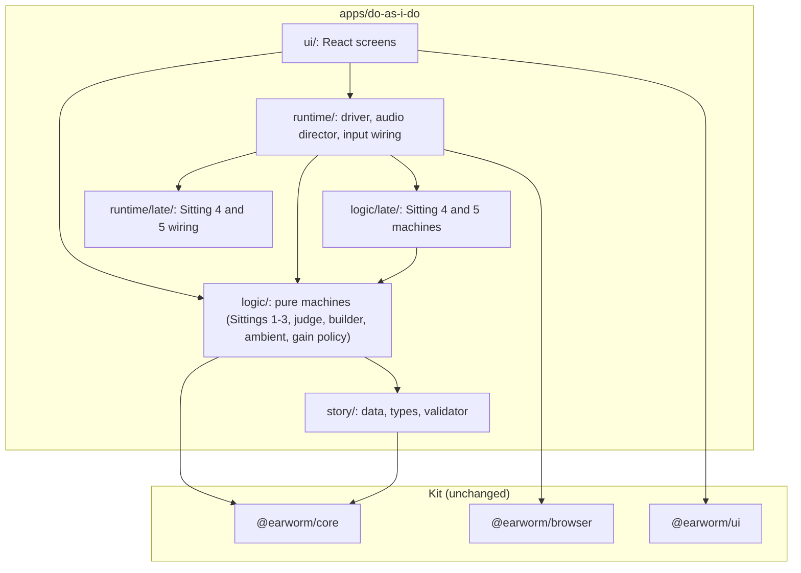
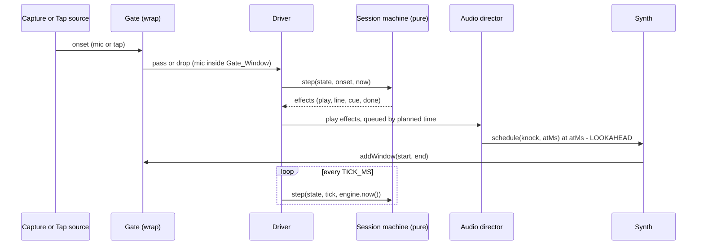
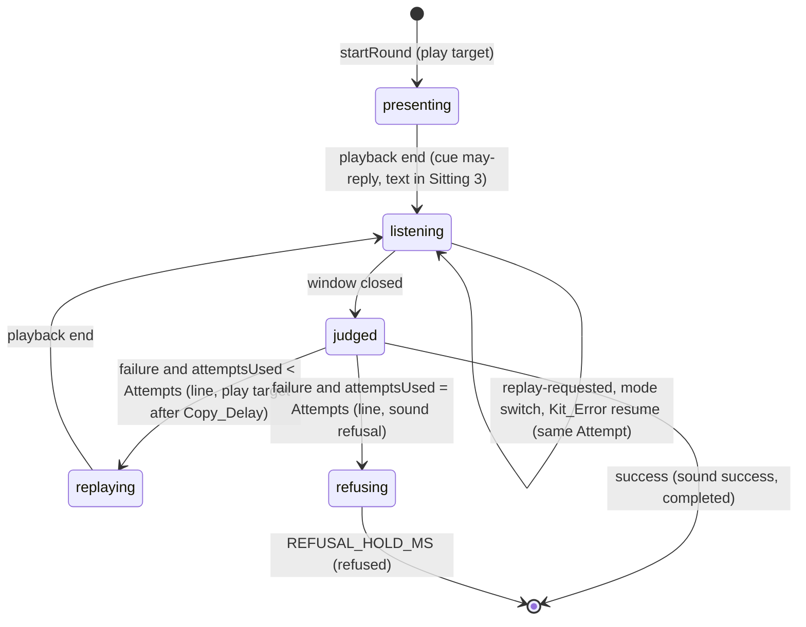

# Design Document

## Overview

Do As I Do is a five-Sitting séance game in `apps/do-as-i-do` (Vite + React), built on the Earworm Kit. This design splits the App into three layers so that every rule in the requirements can be tested without a microphone, an `AudioContext` or a DOM:

| Layer   | Directory                      | May import                             | Contains                                                                                                                        |
| ------- | ------------------------------ | -------------------------------------- | ------------------------------------------------------------------------------------------------------------------------------- |
| Story   | `apps/do-as-i-do/src/story/`   | `@earworm/core` (types only)           | Story_Script data, its types, its validator                                                                                     |
| Logic   | `apps/do-as-i-do/src/logic/`   | `@earworm/core`, `src/story/`          | Pure state machines, judge, Sitting 3 builder, ambient gain scheduler, gain policy, begin rule, reveal. No time, no randomness. |
| Runtime | `apps/do-as-i-do/src/runtime/` | everything above, `@earworm/browser`   | Driver loop, Synth/Gate/Capture/Tap wiring, audio director, `Math.random` Random_Source                                         |
| UI      | `apps/do-as-i-do/src/ui/`      | everything above, `@earworm/ui`, React | Screens, scene, captions, Answer log                                                                                            |

Logic never imports React, `@earworm/browser` or `@earworm/ui`. A new dependency-cruiser rule enforces this (see Testing Strategy). Sittings 4 and 5 (Requirement 11) live in `src/logic/late/` and `src/runtime/late/`, so Sittings 1 to 3 can ship and be tested first.

### Design principles

1. **Time is a parameter.** Every logic function takes `nowMs` (or an event Timestamp) in milliseconds on the Audio_Clock. No logic file reads `Date.now`, `performance.now`, `AudioContext.currentTime` or `Math.random` (Requirement 17.19). A test scans `src/logic` and `src/story` for those tokens.
2. **Machines are reducers.** Each machine is `step(state, input, nowMs) → { state, effects }`. Effects are plain data (`play`, `line`, `cue`, `sound`, `done`). The Runtime executes them. A test replays inputs through the reducer and checks the effects, with a fake clock that is only a number.
3. **Results do not depend on tick rate.** Deadlines are stored in the state as Timestamps, and a window or period that ended is closed at its own deadline, not at the time the tick arrived. An onset whose Timestamp is at or after a deadline closes the period first and is then rejected. So any extra `tick` input changes nothing (Property 9).
4. **Randomness is injected.** The two places that draw (Sitting 3 builder, Sitting 4 answer delay) take a `RandomSource = () => number` in `[0, 1)`. Tests feed a recorded sequence of values.
5. **No new dependency.** Everything uses the standard library, React and the Kit.

### Research summary

- **Kit surface used** (read from `packages/*/src/index.ts`): from `@earworm/core`: `match`, `intervalsToPattern`, `Pattern`, `Ms`, `Result`, `ok`, `err`, `KitError`, `OnsetEvent`, `EventSource`, `createReplaySource`, `parseRecording`. From `@earworm/browser`: `createAudioEngine`, `createGate`, `createSynth`, `createCapturePipeline`, `createTapSource`, `createCalibrationStore`, `createCalibrator`, `canUseMic`, `validateScheduleRequest`. From `@earworm/ui`: `MicCheck`, `useEvents`, `useCalibrationState`.
- **`match` behaviour.** It normalises both Patterns to start at 0 and, for equal counts, to the target's duration, so shift and scale invariance (Requirement 10.6) comes from the Kit. For unequal counts the score is `term × matched / max(n, m)`, which can still be above 0.8 (for example 7 of 8 hits matching perfectly gives 0.875). The App judge therefore rejects unequal hit counts itself (decision D3).
- **Synth.** `schedule(voice, atMs, { frequency, durationMs, gain, ungated })` validates gain in 0 to 1 and duration in 1 to 60,000 ms. The built-in `knock` Voice lasts a fixed 120 ms. `stop()` is permanent (later calls reject with `synth-stopped`). A sound has a constant `gain` and cannot be cancelled once scheduled, so the Runtime schedules each Presence knock only `LOOKAHEAD_MS` before it plays (decision D5).
- **Gate.** `createGate()` defaults to `ignore-synth`. It drops only `source === "mic"` Events inside `[start, end + tail]` of a window. Tap and replay Events always pass, so the App filters by source itself (Requirement 6.3, 6.4).
- **Capture and Tap.** Both are `EventSource`s. The Runtime wraps the Capture_Pipeline with `gate.wrap(...)` and feeds Events to the active machine. `tap.subscribeErrors` and a rejected `capture.start()` give the Kit_Error inputs of Requirement 6.8 and 6.9.
- **Existing test conventions.** `tests/helpers/pbt.ts` exposes `pbtParams()` (100 runs locally, 200 in CI, injected by `vitest.config.mts`). Tests live under `tests/<area>/` and import packages by name. `tests/tsconfig.json` includes every `.ts` and `.tsx` under `tests/`.

## Architecture



### Runtime data flow



The Driver delivers every Event whose Timestamp is at or before `now` before it delivers the `tick` for `now`. The machines do not depend on that order (principle 3), but it keeps the UI responsive.

### How tests import app code

The App is an npm workspace member, like the Kit packages. Its `package.json` has a `name` and an `exports` map that point at TypeScript source, the same way `packages/core/package.json` does. Tests import by package name. No relative path into `apps/` or `packages/` is used and no path alias is needed.

```json
{
  "name": "do-as-i-do",
  "version": "0.0.0",
  "private": true,
  "type": "module",
  "exports": {
    "./story": "./src/story/index.ts",
    "./logic": "./src/logic/index.ts",
    "./logic/late": "./src/logic/late/index.ts",
    "./runtime": "./src/runtime/index.ts",
    "./ui": "./src/ui/index.ts"
  },
  "dependencies": {
    "@earworm/core": "*",
    "@earworm/browser": "*",
    "@earworm/ui": "*",
    "react": "^19.3.1",
    "react-dom": "^19.3.1"
  },
  "scripts": { "typecheck": "tsc --noEmit -p tsconfig.json" }
}
```

- This lists only the dependencies of Requirement 16.3. `npm install` links the workspace into `node_modules/do-as-i-do` (a `package-lock.json` change, no new package).
- `.dependency-cruiser.js` already has `exportsFields` and `conditionNames` set, so `do-as-i-do/logic` resolves to `apps/do-as-i-do/src/logic/index.ts`. The rule `tests-use-package-names` only forbids paths into `packages/`, so tests importing the App by name pass.
- `apps/do-as-i-do/tsconfig.json` extends the root file with `"include": ["src"]`, like the Kit packages. The root `npm run typecheck` already runs `--workspaces --if-present`.
- The `"./logic"` entry re-exports no React and no Kit browser code, so it also loads in the Node-based Vitest project.

### Directory layout

```
apps/do-as-i-do/
  package.json  tsconfig.json  index.html  vite.config.ts  README.md (Manual_Device_Check)
  src/
    story/
      types.ts            StoryScript, SittingConfig, StoryIssue
      story-script.ts     THE DATA FILE (placeholder text, see Data Models)
      validate.ts         validateStoryScript(unknown) -> ValidationResult
      index.ts
    logic/
      constants.ts        app constants (KNOCK_DURATION_MS, ...)
      types.ts            RandomSource, OnsetLike, Effect, SittingInput, ...
      accept.ts           Accepted_Onset filter
      listening.ts        Listening_Window
      playback.ts         planPlayback(pattern, firstAtMs)
      judge.ts            judge(target, reply, ...)
      lines.ts            Presence line selection
      copy.ts             Sitting 1 machine
      round.ts            Round machine (Sitting 2 and the copy step of Sitting 3)
      spot-builder.ts     Sitting 3 Extra_Knock builder
      spot.ts             Sitting 3 machine (listen step, then a Round)
      sittings.ts         dispatch for Sittings 1-3 (+ late registry hook)
      session.ts          Session machine (screens, Dread_Level, Answer log, Refusal, restart)
      setup.ts            canBegin(), input-mode rules
      reveal.ts           typewriter reveal
      ambient-plan.ts     ambient gain scheduler with ramps
      gain-policy.ts      peak gain per sound and Jump_Scare_Toggle
      play-queue.ts       lookahead queue of planned knocks
      index.ts
      late/
        answering.ts      Sitting 4 machine
        hold-plan.ts      Sitting 5 plan (5 patterns, Silence_Start)
        hold.ts           Sitting 5 machine
        index.ts
    runtime/
      driver.ts  audio-director.ts  ambient-rig.ts  input.ts  random.ts  index.ts
      late/ (Sitting 4 and 5 wiring: answer-knock queue, silence cue)
    ui/  main.tsx
```

### Key decisions

| ID  | Decision                                                                                                     | Rationale                                                                                                        | Alternative                                             |
| --- | ------------------------------------------------------------------------------------------------------------ | ---------------------------------------------------------------------------------------------------------------- | ------------------------------------------------------- |
| D1  | Reducers returning data effects                                                                              | Tests need no mocks of Web Audio or timers                                                                       | Classes that call Synth directly: need fakes everywhere |
| D2  | App is a workspace package with an `exports` map                                                             | Matches how the Kit is imported and how `tests-use-package-names` is written; no alias, no relative import       | Vite/Vitest path alias: extra config, tsconfig `paths`  |
| D3  | The judge requires an equal hit count, for Sitting 2 as well as Sitting 3                                    | `match` can score 0.875 for one missing hit in eight, which would pass at 0.8 and break Requirement 17.3         | Threshold only: fails 17.3 for long patterns            |
| D4  | The Sitting 3 Extra_Knock offset is clamped to `interval − Min_Gap`                                          | Requirement 9.8 formula can exceed it for non-integer intervals (Audio_Clock Timestamps are floats), see Gaps G1 | Round Player Timestamps to integers: changes Reply data |
| D5  | Presence knocks are queued and given to the Synth `LOOKAHEAD_MS` (250 ms) before they play                   | `Synth.schedule` cannot be cancelled and `stop()` is permanent; Requirement 6.9 needs pending answers discarded  | Schedule everything at once: cannot discard             |
| D6  | Ambient gain is a plan of linear ramps applied to one `GainNode` owned by an App Voice                       | The Synth gain is constant per sound; ramps of at least 1,000 ms need an `AudioParam`                            | Re-schedule many short sounds: audible steps            |
| D7  | Sittings 4 and 5 are separate modules registered into the Session machine through a `LateSittings` interface | Requirement 11 can be built later without touching Sittings 1 to 3                                               | One file per Session: couples everything                |

## Components and Interfaces

All code is strict TypeScript (root `tsconfig.json`: `noUncheckedIndexedAccess`, `exactOptionalPropertyTypes`, `verbatimModuleSyntax`), ESM, `.js` import suffixes as in the Kit.

### Shared logic types (`logic/types.ts`, `logic/constants.ts`)

```ts
import type { Ms, Pattern, EventSourceName, KitError } from "@earworm/core";

export type RandomSource = () => number; // [0, 1)
export type InputMode = "mic" | "tap";
export interface OnsetLike {
  readonly timestamp: Ms;
  readonly source: EventSourceName;
}

export const KNOCK_DURATION_MS = 120; // length of the Synth "knock" Voice
export const LOOKAHEAD_MS = 250; // Synth.schedule is called this long before a knock plays
export const TICK_MS = 20; // Driver tick period (<= 25 ms keeps the 50 ms limits)
export const LISTEN_QUIET_MS = 2_000; // Listening_Window ends this long after the last Accepted_Onset
export const LISTEN_IDLE_MS = 12_000; // ... or this long after it opened with none
export const REOPEN_DELAY_MS = 400; // "again" / "slower": new window within 500 ms
export const REFUSAL_HOLD_MS = 2_000; // Refusal line shown this long (limit 3,000 ms)
export const REVEAL_CPS = 30; // characters per second (20 to 40)
export const AMBIENT_MAX_GAIN = 0.15;
export const AMBIENT_MIN_RAMP_MS = 1_000;
export const AMBIENT_STOP_RAMP_MS = 2_000; // ambient silent before the 3,000 ms limit
export const MIN_HITS_TO_REPLY = 2; // Min_Reply_Hits is fixed at 2
```

### Accepted_Onset filter (`logic/accept.ts`)

One function owns the Accepted_Onset definition from the Glossary, so Sittings 1 to 5 cannot drift apart.

```ts
export interface Counting {
  readonly fromMs: Ms; // inclusive
  readonly toMs: Ms | null; // exclusive, null = open ended
  readonly lastAcceptedMs: Ms | null;
}
export function acceptOnset(
  counting: Counting,
  mode: InputMode,
  e: OnsetLike,
  debounceMs: number,
): { accepted: boolean; counting: Counting };
```

Accepted when `e.source === mode`, `fromMs ≤ e.timestamp < toMs`, and `lastAcceptedMs === null || e.timestamp − lastAcceptedMs ≥ debounceMs`. An Event rejected by source, range or debounce leaves `counting` unchanged. The Gate has already dropped gated mic Events before they reach this function.

### Listening_Window (`logic/listening.ts`)

```ts
export interface ListeningWindow {
  readonly startMs: Ms;
  readonly maxHits: number | null; // 7 for the listen steps of Sittings 1 and 3; null elsewhere
  readonly hits: readonly Ms[]; // accepted Timestamps, ascending
}
export type Closed = {
  endMs: Ms;
  hits: readonly Ms[];
  reason: "quiet" | "idle" | "max-hits";
};
export function openWindow(
  startMs: Ms,
  maxHits: number | null,
): ListeningWindow;
export function windowDeadline(w: ListeningWindow): Ms; // last hit + 2000, or start + 12000 when no hit
export function windowOnset(
  w: ListeningWindow,
  mode: InputMode,
  e: OnsetLike,
  debounceMs: number,
): { window: ListeningWindow; closed: Closed | null };
export function windowTick(
  w: ListeningWindow,
  nowMs: Ms,
): { closed: Closed | null };
```

- `windowOnset` first checks `e.timestamp ≥ windowDeadline(w)`. If so the window closes at its deadline with reason `quiet` or `idle`, and the Event is not counted. Otherwise it applies `acceptOnset`. When the accepted hit is the `maxHits`-th, the window closes at that hit's Timestamp with reason `max-hits`.
- `windowTick` closes the window at `windowDeadline(w)` when `nowMs ≥ windowDeadline(w)`. The `endMs` is the deadline, not `nowMs`.
- A closed window is discarded by the caller. The Event stream after a close is ignored until the next `openWindow`.

### Playback planning (`logic/playback.ts`)

```ts
export interface PlayPlan {
  readonly hits: readonly Ms[]; // absolute start Timestamps of each knock
  readonly endMs: Ms; // last hit + KNOCK_DURATION_MS
}
export function planPlayback(pattern: Pattern, firstAtMs: Ms): PlayPlan;
```

`hits[i] = firstAtMs + (pattern[i] − pattern[0])`, so every interval is preserved exactly (Requirement 5.1, 7.3, 9.12). The Runtime hands `hits` to the Synth unchanged.

### Judge (`logic/judge.ts`)

```ts
export type Reason =
  | "ok"
  | "too-many"
  | "too-few"
  | "timing"
  | "too-short"
  | "silence";
export interface Judgement {
  readonly success: boolean;
  readonly score: number;
  readonly reason: Reason;
}
export function judge(
  target: Pattern,
  reply: Pattern,
  passThreshold: number,
): Judgement;
```

Order of checks:

1. `reply.length === 0` → `{ success: false, score: 0, reason: "silence" }` (Requirement 6.7, no Matcher call).
2. `reply.length < 2 && target.length ≥ 2` → `too-short`, unsuccessful, regardless of score (Requirement 10.7).
3. `reply.length > target.length` → `too-many`; `reply.length < target.length` → `too-few`. Both unsuccessful (decision D3; covers Requirement 10.8).
4. Otherwise `const r = match(target, reply)`; success iff `r.score ≥ passThreshold`; reason `ok` or `timing`.

`judge` is a pure function of its three arguments (Requirement 10.9). The Presence line category (Requirement 10.5) is the `reason`.

### Story_Script validator (`story/validate.ts`)

```ts
export type Rule =
  | "empty-script"
  | "duplicate-sitting"
  | "wrong-sitting-count"
  | "wrong-sitting-type"
  | "missing-answer"
  | "extra-answer"
  | "missing-ending"
  | "extra-ending"
  | "broke-forbidden-word"
  | "missing-pattern"
  | "extra-pattern"
  | "pattern-limit"
  | "duplicate-pattern"
  | "gain-limit"
  | "config-missing"
  | "config-range"
  | "dread-table";
export interface StoryIssue {
  readonly rule: Rule;
  readonly sitting?: number; // 1..5 when the issue belongs to a Sitting
  readonly sudden?: string; // Sudden_Sound id
  readonly setting?: string; // Sitting_Config name
  readonly message: string; // always names the sitting / sound / setting and the rule
}
export type ValidationResult =
  | { ok: true; value: StoryScript }
  | { ok: false; issues: readonly StoryIssue[] };
export function validateStoryScript(input: unknown): ValidationResult;
```

- It never throws and reads no clock. It collects every issue, in Sitting order, so one run reports all problems.
- Rules (Requirement 16.6 to 16.15): exactly 5 Sittings numbered 1 to 5 in order with Sitting_Types `copy, lead, spot, answer, hold`; exactly one Answer for Sittings 1 to 4; for Sitting 5 exactly the two Endings `broke` and `held` and no Answer; Sitting 2 has one Knock_Pattern, Sitting 5 has `Hold_Pattern_Count` of them, the others none; each Knock_Pattern has 3 to 8 hits (2 to 7 intervals), each interval a finite positive number, total 1,500 to 6,000 ms; patterns pairwise distinct (different count, or some interval differs by more than 5 ms); every Sudden_Sound has `onGain ∈ [0, 1]` and `offGain ∈ [0, quietPeakGainLimit]`; every other sound gain and the knock gains `≤ quietPeakGainLimit`; every ambient gain `≤ 0.15`; the `broke` Ending text has none of `knock, knocked, tap, tapped, rap, rapped` as a whole word, case-insensitive (`/\b(knock|knocked|tap|tapped|rap|rapped)\b/i`).
- Config: each Sitting_Config value is checked against the table in the requirements Glossary (`CONFIG_SPEC`), plus `answerDelayMin ≤ answerDelayMax`. A missing or out of range value gives `config-missing` or `config-range` with `setting` set (Requirement 16.15, 10.4).
- The Dread table must have exactly 6 entries (Dread_Level 0 to 5), each with an ambient gain in `[0, 0.15]`.
- The App calls `validateStoryScript(storyScriptData)` once at load. On failure it shows the issue messages and refuses to start the Session. The test suite calls the same function on the shipped data (Requirement 16.12) and fails with the issue messages.

### Presence lines (`logic/lines.ts`)

```ts
export type LineKey =
  | "again"
  | "slower"
  | "silence"
  | "too-many"
  | "too-few"
  | "timing"
  | "refusal"
  | "intro"
  | "retry-audio";
export function pickLine(lines: readonly string[], index: number): string; // lines[index mod length]
```

Line choice uses an index (attempt number or refusal count), never a random draw, so Sitting 3 stays the only user of randomness besides Sitting 4 (Requirement 9.5). The Judgement reason maps to a `LineKey` one-to-one (`too-many`, `too-few`, `timing`, `silence`; `too-short` uses `too-few`).

### Effects and inputs (`logic/types.ts`)

```ts
export type Effect =
  | {
      kind: "play";
      id: string;
      hits: readonly Ms[];
      role: "presence" | "replay" | "copy" | "answer" | "hold";
      variant: "normal" | "dread3";
    }
  | { kind: "cancel-plays" }
  | { kind: "line"; key: LineKey; index: number }
  | { kind: "text"; text: string } // "One of those wasn't yours."
  | { kind: "cue"; cue: "may-reply" | "stay-silent" | "again" }
  | { kind: "pulse"; atMs: Ms } // one per Accepted_Onset
  | { kind: "sound"; sound: "success" | "refusal" }
  | { kind: "kit-error"; error: KitError }
  | { kind: "audio-unavailable" };

export type SittingInput =
  | { kind: "tick" }
  | { kind: "onset"; event: OnsetLike }
  | { kind: "replay-requested" }
  | { kind: "input-mode"; mode: InputMode }
  | { kind: "kit-error"; error: KitError }
  | { kind: "resume" } // after a Kit_Error in Sittings 1 to 3
  | { kind: "audio-failed" }
  | { kind: "audio-retry" }
  | { kind: "intro-finished" }; // Sittings 4 and 5

export type SittingResult =
  | { kind: "completed"; ending?: "broke" | "held" }
  | { kind: "refused" }
  | { kind: "halted"; error: KitError }; // Sittings 4 and 5 only

export interface StepResult<S> {
  readonly state: S;
  readonly effects: readonly Effect[];
  readonly done?: SittingResult;
  readonly wakeAtMs: Ms | null; // next deadline the Driver must tick at, or null
}
```

`wakeAtMs` lets the Driver sleep until the next deadline. The Driver still ticks every `TICK_MS` (it also feeds the UI), so `wakeAtMs` is mostly for tests that step to an exact deadline.

### Sitting 1, "It copies you" (`logic/copy.ts`)

```ts
export type CopyState =
  | { phase: "listening"; window: ListeningWindow }
  | { phase: "reopening"; reopenAtMs: Ms }
  | { phase: "copying"; endMs: Ms }
  | { phase: "paused" | "awaiting-audio" /* resume data */ }
  | { phase: "finished" };
export function startCopy(
  cfg: SittingConfig,
  mode: InputMode,
  nowMs: Ms,
): StepResult<CopyState>;
export function stepCopy(
  s: CopyState,
  input: SittingInput,
  nowMs: Ms,
  cfg: SittingConfig,
  mode: InputMode,
): StepResult<CopyState>;
```

- `startCopy` opens a window at `nowMs` with `maxHits = Max_Reply_Hits` and emits `cue may-reply`.
- On `closed` with `hits.length ≥ 2`: `planPlayback(intervalsToPattern(...), closed.endMs + Copy_Delay)`, emit one `play` effect with that plan, and go to `copying` with `endMs = plan.endMs`. The Reply_Pattern is the hit list, so the copy has the same number of knocks and the same intervals. No `judge`, no `match` call (Requirement 7.7).
- On `closed` with fewer than 2 hits: emit `line again`, go to `reopening` with `reopenAtMs = closed.endMs + REOPEN_DELAY_MS`, discard the hits. At `reopenAtMs` open a new window and emit `cue may-reply`.
- At `tick` with `nowMs ≥ endMs` in `copying`: emit `done: { kind: "completed" }`. The Session starts the Answer reveal at once (within 500 ms of playback end, Requirement 7.8).
- Sitting 1 has no Attempt count and returns no `refused` (Requirement 7.9).

### Round machine, Sittings 2 and 3 (`logic/round.ts`)

A Round holds the Target_Pattern, the Attempts used, and one phase at a time.

```ts
export interface RoundState {
  readonly sitting: 2 | 3;
  readonly target: Pattern;
  readonly attemptsUsed: number;
  readonly phase:
    | { kind: "presenting"; endMs: Ms; reopenAs: "attempt" } // target is playing
    | { kind: "listening"; window: ListeningWindow }
    | { kind: "replaying"; endMs: Ms } // after a failed Attempt or a replay request
    | { kind: "paused" } // Kit_Error, input switch pending
    | { kind: "awaiting-audio"; pending: Effect }
    | { kind: "refusing"; untilMs: Ms };
  readonly dread: number;
  readonly textAtEnd: string | null; // "One of those wasn't yours." in Sitting 3
}
export function startRound(
  init: {
    sitting: 2 | 3;
    target: Pattern;
    playAtMs: Ms;
    dread: number;
    textAtEnd: string | null;
  },
  cfg: SittingConfig,
): StepResult<RoundState>;
export function stepRound(
  s: RoundState,
  input: SittingInput,
  nowMs: Ms,
  cfg: SittingConfig,
  mode: InputMode,
  story: StoryLines,
): StepResult<RoundState>;
```



- **Presenting.** `startRound` emits a `play` effect (`role: "presence"`). When `nowMs ≥ endMs`, the phase becomes `listening` with `openWindow(endMs, null)` and the effects `cue may-reply` (and `text` when `textAtEnd` is set). The window starts at `endMs`, so the opening is exact (Requirement 5.3, 9.13).
- **Judging.** On a closed window: `judge(target, hits, cfg.passThreshold)`. Every close consumes one Attempt, including a silent window (`reason: "silence"`, Requirement 6.7). Success emits `sound success` and `done completed`. Failure with Attempts left emits `line` for the reason, `play` of the same `target` (`role: "replay"`, `variant: dread ≥ 3 ? "dread3" : "normal"`) at `closed.endMs + Copy_Delay`, and goes to `replaying`. The same `target` and so the same Extra_Knock position is used every time (Requirement 9.10, 9.15).
- **Refusal.** The last failed Attempt emits `line refusal`, `sound refusal` (never `success`, Requirement 13.5) and enters `refusing` with `untilMs = nowMs + REFUSAL_HOLD_MS`. At `untilMs` it emits `done refused`. The Session shows the Sitting_Start_Screen of the same Sitting.
- **Replay request.** Ignored while `presenting`, `replaying` or `refusing` (Requirement 5.7). While `listening` it discards the open window's hits, plays the target (`role: "replay"`), and reopens a window after playback, without changing `attemptsUsed` (Requirement 5.6, 13.7).
- **Interruptions.** `input-mode` clears the window's hits and keeps `attemptsUsed`; the new mode applies from that moment (Requirement 6.11). `kit-error` closes the window, discards hits, goes to `paused`, emits `kit-error`, and never consumes an Attempt (Requirement 6.8). `resume` opens a fresh window. `audio-failed` while `presenting` or `replaying` goes to `awaiting-audio` with the `play` effect saved; `audio-retry` re-emits it (Requirement 5.5).
- **Hit cap.** The Round's window has `maxHits = null`. The Max_Reply_Hits cap would make an 8-hit Sitting 3 target unwinnable (see Gaps G2).

### Sitting 3 builder (`logic/spot-builder.ts`)

```ts
export type SpotBuild =
  | {
      kind: "built";
      target: Pattern;
      extraIndex: number;
      extraAtMs: Ms;
      intervalIndex: number;
    }
  | { kind: "too-short" } // fewer than 2 hits
  | { kind: "no-eligible-interval" };
export function buildSpotTarget(
  hits: readonly Ms[],
  minGapMs: number,
  random: RandomSource,
): SpotBuild;
```

1. `hits.length < 2` → `too-short`. No draw.
2. `p[i] = hits[i] − hits[0]`, `gap_i = p[i+1] − p[i]`. Eligible intervals are those with `gap_i ≥ 2 × minGapMs`. None → `no-eligible-interval`, no draw.
3. Otherwise draw `r1` then `r2`, in that order, exactly once:
   - `k = min(count − 1, floor(r1 × count))` and the chosen interval is the k-th eligible one.
   - `offset = min(gap − minGapMs, minGapMs + floor(r2 × (gap − 2 × minGapMs + 1)))`.
   - `extraAtMs = p[i] + offset`; the target is `p` with `extraAtMs` inserted after index `i`.
4. The clamp in `offset` equals the requirement formula for integer-ms gaps and keeps `offset ∈ [minGap, gap − minGap]` for float gaps (decision D4).

The Sitting 3 machine calls the builder once per listen step that yields at least 2 hits, so a "again" or "slower" re-listen draws nothing, and a Round draws exactly two values (Requirement 9.10).

### Sitting 3 machine (`logic/spot.ts`)

```ts
export type SpotState =
  | { phase: "listen"; window: ListeningWindow }
  | { phase: "reopening"; reopenAtMs: Ms }
  | { phase: "round"; round: RoundState }
  | { phase: "paused" | "awaiting-audio" /* resume data */ };
```

- Listen step: window with `maxHits = Max_Reply_Hits` (2 to 7 hits). Closed with fewer than 2 hits: `line again`, reopen after `REOPEN_DELAY_MS`, Attempts stay 0 (Requirement 9.4). Otherwise `buildSpotTarget`. `no-eligible-interval`: `line slower`, reopen the same way (Requirement 9.7).
- On `built`: `startRound({ sitting: 3, target, playAtMs: closed.endMs + Copy_Delay, dread, textAtEnd: "One of those wasn't yours." })`. The phase becomes `round`, and later inputs go to `stepRound`.
- A new Round after a Refusal starts from a fresh `startSpot`, so the Player_Pattern, Target_Pattern, Extra_Knock and Random_Source draws are all new (Requirement 9.17).
- The `RandomSource` is a parameter of `stepSpot`, so no module state holds it.

### Sitting 4, "It answers" (`logic/late/answering.ts`)

```ts
export interface AnsweringState {
  readonly phase: "intro" | "answering" | "draining" | "halted" | "finished";
  readonly t0Ms: Ms | null;
  readonly counting: Counting;
  readonly pending: readonly { atMs: Ms; endMs: Ms }[]; // scheduled answer knocks
}
export function stepAnswering(
  s: AnsweringState,
  input: SittingInput,
  nowMs: Ms,
  cfg: SittingConfig,
  mode: InputMode,
  random: RandomSource,
): StepResult<AnsweringState>;
```

- `intro-finished` sets `t0Ms = nowMs` and opens `Counting { fromMs: t0, toMs: t0 + Answering_Period }`. Requirement 11.1.
- On `onset`: drop pending entries with `endMs ≤ event.timestamp`; accept via `acceptOnset` only if `pending.length < Max_Pending_Answers`. On acceptance draw `r`, compute `D = min(Answer_Delay_Max, Answer_Delay_Min + floor(r × (Answer_Delay_Max − Answer_Delay_Min + 1)))`, emit `play` (`role: "answer"`) at `t + D`, and add `{ atMs: t + D, endMs: t + D + KNOCK_DURATION_MS }`. One draw per accepted onset, none otherwise. Emit `pulse`.
- `done completed` when `nowMs ≥ max(t0 + Answering_Period, last pending endMs)`. With no onset, that is `t0 + Answering_Period` (Requirement 11.9).
- `kit-error` emits `cancel-plays`, clears `pending` and `counting`, and gives `done halted`. `resume` is not used: the Session returns to the Sitting_Start_Screen, so a retry starts a new period (Requirement 6.9, 6.10).
- No `refused` result exists (Requirement 11.16).

### Sitting 5, "Don't answer" (`logic/late/hold-plan.ts`, `logic/late/hold.ts`)

```ts
export interface HoldPlan {
  readonly plays: readonly PlayPlan[]; // 5 plans in story order
  readonly silenceStartMs: Ms; // last knock of the last plan + KNOCK_DURATION_MS
}
export function planHold(
  patterns: readonly Pattern[],
  introEndMs: Ms,
  patternGapMs: number,
): HoldPlan;
```

- `plays[0]` starts at `introEndMs + patternGapMs`. `plays[j+1]` starts at `plays[j].endMs + patternGapMs`, so the gap is measured from the previous Pattern's last knock end to the next first knock (Requirement 11.10). `silenceStartMs = plays[4].endMs`.
- `stepHold` states: `intro` → `playing` (on `intro-finished`: `planHold`, emit the five `play` effects, `cue` none) → `silence` (at `nowMs ≥ silenceStartMs`: emit `cue stay-silent`) → finished.
- During `playing`, every onset is ignored (Requirement 11.11). During `silence`, `acceptOnset` with `Counting { from: silenceStart, to: silenceStart + Silence_Duration }`. The first accepted onset gives `done completed, ending: "broke"`. Reaching `silenceStart + Silence_Duration` gives `ending: "held"`. A late onset first closes the period (principle 3). Requirement 11.12 to 11.15.
- `kit-error` emits `cancel-plays` and gives `done halted`.

### Session machine (`logic/session.ts`)

```ts
export type Screen =
  | "content-warning"
  | "mic-check"
  | "sitting-start"
  | "sitting"
  | "refusal"
  | "reveal"
  | "final"
  | "story-invalid";

export interface SessionState {
  readonly screen: Screen;
  readonly inputMode: InputMode;
  readonly jumpScare: boolean; // survives restart
  readonly completed: number; // 0..5, equals Dread_Level
  readonly answerLog: readonly string[];
  readonly current: SittingNumber; // 1..5, the Sitting being started or played
  readonly sitting: SittingState | null;
  readonly refusals: Readonly<Record<2 | 3, number>>;
  readonly reveal: RevealState | null;
  readonly ending: "broke" | "held" | null;
  readonly setup: SetupState; // permission, calibration, skip, audio error
}
export type SessionInput =
  | { kind: "start-pressed" }
  | { kind: "audio-ready" }
  | { kind: "audio-failed" }
  | { kind: "setup"; change: SetupChange }
  | { kind: "begin-pressed" }
  | { kind: "begin-sitting-pressed" }
  | { kind: "toggle-jump-scare"; on: boolean }
  | { kind: "skip-reveal" }
  | { kind: "restart" }
  | SittingInput;
export function initialSession(story: StoryScript): SessionState;
export function stepSession(
  s: SessionState,
  input: SessionInput,
  nowMs: Ms,
  deps: { story: StoryScript; random: RandomSource; late: LateSittings | null },
): StepResult<SessionState> & { dread: number };
```

- `begin-pressed` is accepted only when `canBegin(setup)` is true (Requirement 1.7, 1.10). `begin-sitting-pressed` is accepted only on `sitting-start` (Requirement 4.8).
- A Sitting result `completed` sets `screen: "reveal"` and starts the Answer reveal. When the reveal finishes or is skipped, the Answer is appended to `answerLog`, `completed` increases by 1 (once per Sitting, Requirement 12.2), and the screen becomes `sitting-start` for the next Sitting or `final` after Sitting 5. The Answer of Sitting 5 is the Ending text (Requirement 12.7).
- Dread_Level is `completed`. It changes at the moment the Sitting is marked completed, which is when the Answer starts showing (Requirement 12.1), so the `dread` field is derived: `completed`. The Runtime sees a `dread` change in the result and tells the ambient director.
- `refused` sets `screen: "refusal"` for `REFUSAL_HOLD_MS`, then returns to `sitting-start` of the same Sitting with `completed`, `answerLog` and Dread unchanged and `refusals[sitting]` incremented (Requirement 13.3, 13.4, 13.6).
- `halted` (Sittings 4 and 5) shows the Kit_Error and returns to `sitting-start` of the same Sitting on retry.
- `restart` returns to `content-warning` with `completed = 0`, an empty `answerLog`, `sitting = null`, `current = 1`, and keeps `jumpScare` (Requirement 3.9, 14.4). The Calibration store is outside the Session state, so it is untouched (Requirement 14.5). Nothing is persisted, so a page reload creates `initialSession` (Requirement 14.6, 14.7).
- `LateSittings` is `{ start4, step4, start5, step5 }`. With `late: null` (Sittings 4 and 5 not built yet), the Session ends after Sitting 3 on a development-only `final` screen. Nothing in Sittings 1 to 3 changes when the late module is added.

### Setup and begin rule (`logic/setup.ts`)

```ts
export type Permission = "prompt" | "granted" | "denied" | "unavailable";
export type CalibrationState =
  | "uncalibrated"
  | "calibrating"
  | "calibrated"
  | "failed";
export function canBegin(a: {
  mode: InputMode;
  permission: Permission;
  calibration: CalibrationState;
  skipCalibration: boolean;
}): boolean {
  return (
    a.mode === "tap" ||
    (a.permission === "granted" &&
      (a.calibration === "calibrated" || a.skipCalibration))
  );
}
```

`unavailable` (`canUseMic()` false) forces `mode: "tap"` in `stepSession` (Requirement 1.3). `denied` does the same (Requirement 1.4). The `CalibrationState` type is the same union as `@earworm/ui`; the logic file declares it locally to avoid importing `@earworm/ui`.

### Reveal (`logic/reveal.ts`)

```ts
export function revealedChars(
  elapsedMs: number,
  length: number,
  cps = REVEAL_CPS,
): number;
// min(length, floor(elapsedMs × cps / 1000)), 0 for negative or non-finite elapsed
```

The Session stores `startedMs` and `skipped`. The visible text is `answer.slice(0, skipped ? length : revealedChars(now − startedMs, length))`. Skip shows the full text on the next tick (within 100 ms with `TICK_MS = 20`).

### Ambient gain scheduler (`logic/ambient-plan.ts`)

```ts
export interface Ramp {
  readonly fromMs: Ms;
  readonly toMs: Ms; // toMs − fromMs >= 1000
  readonly fromGain: number;
  readonly toGain: number; // 0 .. 0.15
}
export interface AmbientState {
  readonly gain: number; // value at the end of the last ramp
  readonly ramp: Ramp | null; // in flight or finished
  readonly stopped: boolean;
}
export function initialAmbient(startGain: number): AmbientState;
export function gainAt(s: AmbientState, tMs: Ms): number; // linear within the ramp
export function onDread(
  s: AmbientState,
  nowMs: Ms,
  targetGain: number,
  rampMs: number,
): { state: AmbientState; ramp: Ramp };
export function onStop(
  s: AmbientState,
  nowMs: Ms,
): { state: AmbientState; ramp: Ramp };
```

- `onDread` starts a ramp at `nowMs` from `gainAt(s, nowMs)` (so an interrupted ramp continues from where it is, with no jump) to `clamp(targetGain, 0, AMBIENT_MAX_GAIN)`, lasting `max(AMBIENT_MIN_RAMP_MS, rampMs)`.
- `onStop` ramps to 0 over `AMBIENT_STOP_RAMP_MS` (2,000 ms), so the Ambient_Sound is silent 2,000 ms after the final scene (limit 3,000 ms, Requirement 14.2). After `stopped`, `onDread` is a no-op.
- The plan is data. `runtime/ambient-rig.ts` applies each `Ramp` to the rig's `GainNode.gain` with `cancelScheduledValues`, `setValueAtTime(fromGain, fromMs/1000)` and `linearRampToValueAtTime(toGain, toMs/1000)`. Tests record the `Ramp`s from the pure functions and, for the Synth-level check, from a fake rig that records the same calls (Requirement 17.16).
- **Ambient Voice.** The Runtime registers one App Voice `"ambient"` with `synth.registerVoice`. Its builder creates a low sine drone and low-passed noise into one rig `GainNode`, whose initial value is `params.gain` (the plan's start gain, at most 0.15). The Synth `schedule` call for `"ambient"` uses `ungated: true` and `gain = startGain`. Because a Synth sound lasts at most 60,000 ms, the rig schedules overlapping 60,000 ms chunks every 59,000 ms. Each chunk fades in and out over 1,000 ms inside the Voice, so chunk joins are smooth. All chunks feed the same rig node, so one set of ramps controls them.
- The Ambient_Sound uses Ungated_Playback, so no Gate_Window covers it. It must not produce Onset_Events by itself. That is checked by the Manual_Device_Check only (Requirement 2.9); the design keeps its level low (at most 0.15 gain, slow ramps, no transients) to make that check pass.

### Gain policy (`logic/gain-policy.ts`)

```ts
export type SoundSpec =
  | {
      kind: "sudden";
      id: string;
      voice: string;
      onGain: number;
      offGain: number;
    }
  | { kind: "normal"; id: string; voice: string; gain: number };
export function peakGain(
  spec: SoundSpec,
  jumpScare: boolean,
  quietLimit: number,
): number;
```

- Sudden: `jumpScare ? clamp(onGain, 0, 1) : min(offGain, quietLimit)`. Normal: `min(gain, quietLimit)`. The result is never negative, never above 1, and with `jumpScare` false never above `quietLimit` (Requirement 3.5 to 3.8).
- The audio director calls `peakGain` for every non-ambient sound it schedules (knock, replay knock at Dread 3 or more, answer knock, success, refusal, Sudden_Sound) and passes the result as the Synth `gain`. The toggle is read at the time each sound starts, so a change applies to later sounds only (Requirement 3.10).

### Play queue (`logic/play-queue.ts`)

```ts
export interface QueuedPlay {
  readonly id: string;
  readonly atMs: Ms;
  readonly role: string;
  readonly variant: "normal" | "dread3";
}
export interface PlayQueue {
  readonly items: readonly QueuedPlay[];
}
export function enqueue(q: PlayQueue, plays: readonly QueuedPlay[]): PlayQueue; // sorted by atMs, stable
export function due(
  q: PlayQueue,
  nowMs: Ms,
): { q: PlayQueue; due: readonly QueuedPlay[] }; // atMs - LOOKAHEAD_MS <= nowMs
export function clear(): PlayQueue;
```

On `cancel-plays` the queue is emptied. Only knocks already given to the Synth (at most `LOOKAHEAD_MS` ahead) still play, and their Gate_Windows are in place, so they cannot be counted (decision D5).

### Runtime (`runtime/`)

Not unit-tested for logic. It is thin and covered by integration tests with fakes.

- **`driver.ts`**: `createDriver({ engine, story, session, deps })`. Holds `SessionState`. Every `TICK_MS` it calls `stepSession(state, { kind: "tick" }, engine.now(), deps)`. It subscribes to `gate.wrap(activeSource)` and forwards each `onset` Event. It executes effects: `play` goes into the `PlayQueue`, `sound`/`line`/`cue`/`pulse`/`text` go to the UI store, `kit-error` shows the error. It converts a failed `Synth.schedule` into an `audio-failed` input (Requirement 5.5) and a failed refusal sound into only a log (Requirement 13.8).
- **`audio-director.ts`**: `createAudioDirector({ synth, gate, now, getJumpScare, story })`. `play(effect)` calls `synth.schedule("knock", atMs, { gain: peakGain(...), durationMs? })` for each hit. `success` uses the `bell` Voice and `refusal` the `bass` Voice (different waveform and pitch, Requirement 13.5). It keeps captions: for each scheduled knock the UI gets a text equivalent within 200 ms of the start (Requirement 15.4).
- **`input.ts`**: builds the active `EventSource`. Microphone mode: `gate.wrap(capturePipeline)`. Tap mode: `gate.wrap(tapSource)`. Switching mode emits `input-mode`. It also sets `gate.setMode("ignore-synth")` once per Session (Requirement 2.10).
- **`random.ts`**: `export const systemRandom: RandomSource = () => Math.random();` is the only `Math.random` call in the App, and lives in `runtime/`.
- **Session lifecycle**: a Session creates one `Gate`, one `Synth`, one `AudioDirector` and one ambient rig. Restart tears them down (`synth.stop()` after the ambient stop ramp, Requirement 14.2) and a new Session creates fresh ones, because `Synth.stop()` is permanent.

### UI (`ui/`)

React 19 components, tested with example-based and snapshot tests. They read the Session store with `useSyncExternalStore` (same pattern as `@earworm/ui` hooks). Screens: `ContentWarningScreen` (warning text, `JumpScareToggle` as `<input type="checkbox" role="switch">` or a native button with `aria-pressed`, start button), `MicCheck` from `@earworm/ui` with the begin button, `SittingStartScreen`, `SittingScreen` (title, input mode text, cue, captions, replay button, Presence line, "stay silent" text in Sitting 5 with no countdown), `RevealPanel` with skip, `AnswerLog`, `FinalScreen` with restart, and `Scene` (room, table, pulse). Reduced motion: `usePrefersReducedMotion()` reads `matchMedia("(prefers-reduced-motion: reduce)")`. When set, the scene uses static brightness per Dread_Level and no animation that repeats faster than 3 times per second.

## Data Models

### Story_Script (`src/story/types.ts`)

```ts
export type SittingType = "copy" | "lead" | "spot" | "answer" | "hold";
export interface KnockPatternData {
  readonly intervals: readonly number[];
} // ms between hits; hits = intervals.length + 1

export interface SittingData {
  readonly number: 1 | 2 | 3 | 4 | 5;
  readonly type: SittingType;
  readonly title: string;
  readonly intro: string; // Presence line shown when the Sitting begins
  readonly answer?: string; // Sittings 1 to 4
  readonly endings?: { readonly broke: string; readonly held: string }; // Sitting 5
  readonly patterns?: readonly KnockPatternData[]; // Sitting 2: 1, Sitting 5: 5
}

export interface SittingConfig {
  readonly passThreshold: number;
  readonly attemptsPerRound: number;
  readonly onsetDebounceMs: number;
  readonly minReplyHits: 2;
  readonly maxReplyHits: number;
  readonly copyDelayMs: number;
  readonly minGapMs: number;
  readonly answeringPeriodMs: number;
  readonly answerDelayMinMs: number;
  readonly answerDelayMaxMs: number;
  readonly maxPendingAnswers: number;
  readonly holdPatternCount: 5;
  readonly patternGapMs: number;
  readonly silenceDurationMs: number;
  readonly quietPeakGainLimit: number;
}

export interface SuddenSoundData {
  readonly id: string;
  readonly voice: string; // a Synth Voice name
  readonly frequency?: number;
  readonly durationMs?: number;
  readonly onGain: number; // 0..1
  readonly offGain: number; // 0..quietPeakGainLimit
  readonly caption: string; // text equivalent
  readonly trigger: {
    readonly sitting: number;
    readonly at: "sitting-start" | "answer-reveal" | "refusal";
  };
}

export interface DreadSettings {
  // index = Dread_Level 0..5
  readonly ambientGain: number; // 0..0.15
  readonly brightness: number; // 0..1
  readonly flicker: number; // 0..1, ignored when reduced motion is set
}

export interface StoryScript {
  readonly config: SittingConfig;
  readonly sittings: readonly SittingData[];
  readonly lines: {
    readonly again: readonly string[];
    readonly slower: readonly string[];
    readonly silence: readonly string[];
    readonly tooMany: readonly string[];
    readonly tooFew: readonly string[];
    readonly timing: readonly string[];
    readonly refusal: {
      readonly 2: readonly string[];
      readonly 3: readonly string[];
    };
    readonly wasntYours: string; // "One of those wasn't yours."
  };
  readonly sounds: {
    readonly knockGain: number;
    readonly knockReplayGainDread3: number;
    readonly successGain: number;
    readonly refusalGain: number;
    readonly sudden: readonly SuddenSoundData[];
  };
  readonly dread: readonly DreadSettings[]; // exactly 6
  readonly ambient: { readonly rampMs: number }; // >= 1000
}
```

Config values come from `story-script.ts` only (Requirement 16.14). Initial values equal the Glossary table: `passThreshold 0.8`, `attemptsPerRound 3`, `onsetDebounceMs 100`, `minReplyHits 2`, `maxReplyHits 7`, `copyDelayMs 1500`, `minGapMs 150`, `answeringPeriodMs 45000`, `answerDelayMinMs 400`, `answerDelayMaxMs 1200`, `maxPendingAnswers 4`, `holdPatternCount 5`, `patternGapMs 1500`, `silenceDurationMs 20000`, `quietPeakGainLimit 0.4`.

### Where the data lives and what is placeholder

The data file is `apps/do-as-i-do/src/story/story-script.ts`. It exports `export const storyScriptData: unknown = { ... }` (typed `unknown` so the validator, not the compiler, is the gatekeeper), and `loadStoryScript()` which returns `validateStoryScript(storyScriptData)`.

**All text in this file is placeholder.** The user will replace it with the final story. The file starts with a comment saying so, and every string is plain text with no logic, so replacing the text cannot break the code. The validator and the test suite protect the structure (5 Sittings, one Answer each, Endings, patterns, gains, forbidden words in the "broke" Ending). The placeholder content, to be rewritten:

| Sitting | Type   | Title                     | Placeholder Answer (history thread)                                                                    |
| ------- | ------ | ------------------------- | ------------------------------------------------------------------------------------------------------ |
| 1       | copy   | It copies you             | "PLACEHOLDER. It was a house in Hydesville, 1848. It began with a sound in the wall."                  |
| 2       | lead   | It leads                  | "PLACEHOLDER. Two sisters answered the sound. They snapped their fingers and it snapped back."         |
| 3       | spot   | One of those wasn't yours | "PLACEHOLDER. They taught it a code. One knock for no, two for yes. It learned the alphabet."          |
| 4       | answer | It answers                | "PLACEHOLDER. Soon the whole country was listening for the spiritual telegraph. It answered everyone." |
| 5       | hold   | Don't answer              | none (two Endings below)                                                                               |

Sitting 5 Endings (placeholders): `broke`: "PLACEHOLDER. Something in the room answered. It was waiting for that." (no knock, tap or rap word). `held`: "PLACEHOLDER. You kept silent. It had never been refused before."

Placeholder Knock_Patterns (intervals in ms): Sitting 2 `[500, 500, 250, 750]` (5 hits, 2,000 ms). Sitting 5: `[400, 400, 800]` (4 hits, 1,600 ms), `[300, 300, 300, 900]` (5 hits, 1,800 ms), `[600, 300, 300, 600, 300]` (6 hits, 2,100 ms), `[250, 250, 250, 250, 750, 750]` (7 hits, 2,500 ms), `[900, 450, 450]` (4 hits, 1,800 ms). All five differ from each other by more than 5 ms in count or interval.

Placeholder Sudden_Sound: `{ id: "slam", voice: "kick", onGain: 0.9, offGain: 0.3, caption: "A heavy thud under the table.", trigger: { sitting: 3, at: "answer-reveal" } }`. Knock gains `0.35` (normal) and `0.25` (Dread 3 or more replay), success `0.3`, refusal `0.3`, ambient gain by Dread `[0.02, 0.04, 0.06, 0.09, 0.12, 0.15]`, ramp 2,000 ms.

### Runtime data

- `SessionState`, `SittingState` (a tagged union over the machines above), `RoundState`, `AmbientState`, `PlayQueue`: plain immutable objects, each field `readonly`. A machine returns a new object and never mutates its argument.
- Timestamps are `Ms` (floats allowed). All counts are integers.
- No data is persisted. The Calibration is held by the Kit `CalibrationStore` for the page lifetime only; the App does not write `localStorage`.

## Gaps and decisions on the requirements

Nothing here edits `requirements.md`. Each item says how the design reads it. Items G1 to G3 are worth a decision from you.

- **G1. Extra_Knock offset formula (Requirement 9.8, 9.9).** `Min_Gap + floor(r2 × (gap − 2 × Min_Gap + 1))` can exceed `gap − Min_Gap` when the gap is not an integer (for example gap − 2 × Min_Gap = 0.5 with r2 above 0.67 gives an offset 0.5 ms too large). The design clamps to `gap − Min_Gap` (D4). For integer gaps it is identical to the requirement. Alternative: round Reply Timestamps to integer ms first.
- **G2. Max_Reply_Hits in the copy step of Sitting 3.** The Glossary says the Listening_Window of Sitting 3 ends at the 7th Accepted_Onset. The listen step needs that cap (Requirement 9.3). The copy step must accept `n + 1` hits, up to 8, so the design applies the cap to the listen step only. A reply with extra hits is judged `too-many`.
- **G3. Judge and hit count (Requirement 10, 17.3).** The requirement lists a hit-count rule only for Sitting 3. The design applies it to Sitting 2 too (D3), because `match` alone can pass a pattern with one missing hit.
- **G4. Window and playback timing.** The window end uses event Timestamps (last hit + 2,000 ms), so the first copy knock in Sitting 1 plays 3,500 ms after the Player's last hit. This follows the Glossary and Requirement 7.3.
- **G5. "Again" and "slower" re-listen.** Requirement 7.6 and 9.4 say "within 500 ms". The design uses `REOPEN_DELAY_MS = 400`. Onsets in that 400 ms are discarded.
- **G6. Draw timing in Sitting 3.** "r1 and r2 exactly once per Round" is read as: drawn when the builder finds an eligible interval, so a re-listen after "slower" draws nothing.
- **G7. Sitting 5 patterns.** The first Pattern starts `Pattern_Gap` after the introduction ends (Requirement 11.10 gives the gap between Patterns only).
- **G8. Presence knock end time.** `KNOCK_DURATION_MS = 120` mirrors the built-in Synth `knock` Voice. The integration test asserts that the Synth returns `endMs − startMs === 120`, so a Kit change to the Voice is caught.

## Correctness Properties

_A property is a characteristic or behavior that should hold true across all valid executions of a system-essentially, a formal statement about what the system should do. Properties serve as the bridge between human-readable specifications and machine-verifiable correctness guarantees._

Reflection on the prework merged these groups: the judge criteria 10.1, 10.2, 10.5, 10.7, 10.8, 10.9 and 6.7 into Property 5; the accepted-onset criteria 6.1 to 6.4, 6.6 and 6.12 into Property 8; the Round criteria 8.3 to 8.5, 9.14 to 9.16, 6.5 and 13.1 into Property 15; the interruption criteria 6.8, 6.11, 5.6, 5.7, 7.6, 9.4 and 9.7 into Property 16; the Presence-knock gating criteria 5.9, 11.5 and 11.11 into Property 20; and the Session criteria 4.1, 4.2, 12.1, 12.2, 12.5, 12.7, 12.8, 13.3, 13.4, 14.4 and 3.9 into Property 23. UI-only criteria and the Manual_Device_Check (Requirement 2.9) have no property.

Generators: patterns are generated as `fc.array(fc.integer({ min: 100, max: 1500 }), { minLength: 2, maxLength: 7 })` intervals and converted with `intervalsToPattern`, filtered to the Knock_Pattern limits (total 1,500 to 6,000 ms). The Random_Source is built from `fc.array(fc.double({ min: 0, max: 1, maxExcluded: true, noNaN: true }))` consumed in order, and it counts its draws. Onset streams are `fc.array` of `{ timestamp, source }` sorted by Timestamp, with `source` from `mic`, `tap`, `replay`.

### Property 1: Begin control rule

For any Input_Mode, microphone permission state, Calibration state and skip choice, `canBegin` returns true if and only if the Input_Mode is Tap mode, or the permission state is "granted" and (the Calibration state is "calibrated" or the Player chose to skip calibration).

**Validates: Requirements 1.7, 17.13**

### Property 2: Valid Story_Scripts are accepted

For any generated Story_Script that has 5 Sittings in order with the types copy, lead, spot, answer, hold, one Answer on each of Sittings 1 to 4, two Endings on Sitting 5, one Knock_Pattern on Sitting 2, 5 distinct Knock_Patterns on Sitting 5, in-limit patterns, in-limit gains, a "broke" Ending with no forbidden word, and in-range config values, `validateStoryScript` returns `{ ok: true }` and the value deep-equals the input.

**Validates: Requirements 16.6, 16.7, 16.8, 16.9, 16.10, 16.11, 16.14**

### Property 3: Every Story_Script violation is reported by rule and location

For any valid Story_Script and any single mutation from the list (remove a Sitting, duplicate a Sitting number, change a Sitting_Type, remove an Answer, add a second Answer, remove or add an Ending, put a forbidden word in the "broke" Ending in any letter case, remove or add a Knock_Pattern, give a pattern 2 or 9 hits or a total outside 1,500 to 6,000 ms, make two patterns equal within 5 ms, raise a gain above its limit, change the Dread table length), `validateStoryScript` returns `{ ok: false }`, and the issues include one with the rule that matches the mutation and a `message` that contains the Sitting number or the Sudden_Sound id. An empty `sittings` list gives the `empty-script` rule, and a duplicated number gives `duplicate-sitting` with that number.

**Validates: Requirements 16.6, 16.7, 16.8, 16.9, 16.10, 16.11, 16.12, 16.13**

### Property 4: Config values are range-checked and named

For any Sitting_Config value that is missing, not a finite number, or outside its range in the requirements table (including `answerDelayMin > answerDelayMax`), `validateStoryScript` returns `{ ok: false }` with an issue whose `setting` is that setting's name and whose rule is `config-missing` or `config-range`. For any Pass_Threshold that is not a number from 0 to 1 inclusive the issue names `passThreshold`.

**Validates: Requirements 10.3, 10.4, 16.15**

### Property 5: Judge decision rule

For any target Pattern, any reply Pattern and any Pass_Threshold in [0, 1], `judge(target, reply, threshold)` is successful if and only if the reply has the same hit count as the target, has at least 2 hits when the target has 2 or more, and `match(target, reply).score ≥ threshold`. An empty reply gives reason `silence` and no `match` call. Fewer than 2 hits gives `too-short`. More hits than the target gives `too-many`, fewer gives `too-few`. Calling `judge` twice with the same arguments gives equal results.

**Validates: Requirements 6.7, 10.1, 10.2, 10.5, 10.7, 10.8, 10.9, 17.3, 17.6**

### Property 6: Judge invariance under shift and scale

For any target Pattern within the Knock_Pattern limits, any offset from 0 to 60,000 ms and any factor from 0.5 to 2.0 inclusive, `judge` marks successful both the reply equal to the target shifted by the offset, and the reply equal to the target with every inter-hit interval multiplied by the factor, and the reply with both applied.

**Validates: Requirements 10.6, 17.2, 17.7**

### Property 7: Playback plan preserves intervals

For any Pattern and any start Timestamp, `planPlayback(pattern, firstAtMs)` returns the same number of hits, `hits[0] = firstAtMs`, every interval equal to the Pattern's interval within 5 ms (exactly, apart from float rounding), and `endMs = last hit + KNOCK_DURATION_MS`.

**Validates: Requirements 5.1, 7.3, 7.4, 9.12**

### Property 8: Accepted_Onset filter

For any Input_Mode, counting range, debounce value and ordered stream of Events, the accepted set is exactly the Events whose source equals the Input_Mode, whose Timestamp lies in the range (inclusive start, exclusive end), and whose Timestamp is at least the debounce after the previous accepted Event. Events of the other source, Events outside the range, and Events inside the debounce leave the state unchanged. The accepted Timestamps are ascending and every neighbouring pair is at least the debounce apart.

**Validates: Requirements 6.1, 6.2, 6.3, 6.4, 6.6, 6.12**

### Property 9: Listening_Window ends by its rules, whatever the tick rate

For any window start, Event stream and any set of extra `tick` times, the window closes at the earliest of: the Timestamp of the `maxHits`-th accepted Event, the last accepted Timestamp plus 2,000 ms, or the start plus 12,000 ms when nothing was accepted. The close time and the list of hits are identical for every choice of extra ticks, including none. After the close no Event is added.

**Validates: Requirements 7.5, 9.3, 17.1**

### Property 10: Sitting 1 copies the reply

For any Event stream that yields at least 2 hits in a Sitting 1 window, the machine emits exactly one `play` effect whose hit count equals the Reply_Pattern's, whose first hit is the window's end plus Copy_Delay, and whose intervals equal the Reply_Pattern's. It emits no `judge`-based sound and never returns `refused`. For a window with fewer than 2 hits it emits no `play`, emits `line again`, and opens a new window within 500 ms.

**Validates: Requirements 7.2, 7.3, 7.4, 7.6, 7.7, 7.9, 17.1**

### Property 11: Sitting 3 builder invariants

For any Player_Pattern of 2 to 7 hits with at least one interval of at least 2 × Min_Gap, and any Random_Source values, `buildSpotTarget` returns `built` with a Target_Pattern of n + 1 hits, in ascending order, in which the Extra_Knock lies strictly between the first and last hit and is at least Min_Gap after the hit before it and at least Min_Gap before the hit after it, and removing the Extra_Knock gives exactly the Player_Pattern (shifted to start at 0).

**Validates: Requirements 9.8, 9.9, 9.11, 17.4**

### Property 12: Sitting 3 builder eligibility, draws and determinism

For any Player_Pattern and any Random_Source, the builder returns `too-short` for fewer than 2 hits and `no-eligible-interval` when no interval is at least 2 × Min_Gap, and in both cases draws zero values. Otherwise it draws exactly two values, `r1` then `r2`; the chosen interval is the `floor(r1 × count)`-th eligible interval; for integer-ms intervals the offset equals `Min_Gap + floor(r2 × (gap − 2 × Min_Gap + 1))`; the same inputs and the same values give the same output.

**Validates: Requirements 9.5, 9.6, 9.7, 9.8, 9.10**

### Property 13: Sitting 3 builder is translation-equivariant

For any Player_Pattern, any Random_Source values and any shift of all hit Timestamps, the builder's Target_Pattern for the shifted input has the same intervals and the same `intervalIndex` and `extraIndex` as for the unshifted input.

**Validates: Requirements 9.8, 9.11, 10.6**

### Property 14: Round attempt accounting

For any sitting (2 or 3), Target_Pattern and sequence of Attempt replies, the Round ends with success at the first Attempt whose judgement succeeds and uses no later Attempt; if no Attempt up to the limit succeeds, the Round ends with a Refusal after exactly the Attempts-per-Round limit; the Attempts used never exceed the limit; a silent window consumes one Attempt and calls no `match`; a Round that ends in success emits `sound success` exactly once and no `sound refusal`; a Round that ends in Refusal emits `sound refusal` exactly once, no `sound success`, and exactly one `line refusal`.

**Validates: Requirements 6.5, 6.7, 8.3, 8.4, 8.5, 9.14, 9.15, 9.16, 13.1, 13.5, 17.8**

### Property 15: Interruptions and short listens do not consume Attempts

For any Round state in `listening`, an `input-mode` input, a `kit-error` input followed by `resume`, or a `replay-requested` input leaves `attemptsUsed` unchanged, discards the hits collected in the open window, and (for `replay-requested` while not playing) replays the same Target_Pattern with the same hit Timestamps relative to the first hit. A `replay-requested` input while a Presence Pattern is playing changes nothing. For Sittings 1 and 3, a listen window with fewer than 2 hits, or in Sitting 3 a Player_Pattern with no eligible interval, leaves the Attempts used at 0 and plays no reply.

**Validates: Requirements 5.6, 5.7, 6.8, 6.11, 7.6, 9.4, 9.7, 17.5**

### Property 16: Sitting 4 answers each accepted knock once

For any Sitting 4 start Timestamp, Event stream and Random_Source values, the machine emits exactly one `play` (role `answer`) per accepted Event and none for any other Event. Each play is at `t + D` with `D = Answer_Delay_Min + floor(r × (Answer_Delay_Max − Answer_Delay_Min + 1))`, an integer from 400 to 1,200 for the defaults, and it draws exactly one value per accepted Event. An Event is accepted only if it is at least the debounce after the previous accepted Event, fewer than Max_Pending_Answers answers are pending, and its Timestamp is at least T0 and less than T0 + Answering_Period.

**Validates: Requirements 11.2, 11.3, 11.4, 11.7, 17.9**

### Property 17: Sitting 4 completion time

For any Sitting 4 run, the machine returns `done completed` at the first tick at or after `max(T0 + Answering_Period, end of the last answer knock)`, and not before. With zero accepted Events the completion time is `T0 + Answering_Period`.

**Validates: Requirements 11.1, 11.8, 11.9, 17.9**

### Property 18: Sitting 5 plan and Ending

For any five Patterns, any introduction end Timestamp and any Pattern_Gap, `planHold` starts the first Pattern at the end plus the gap, starts each next Pattern the gap after the previous Pattern's last knock end, and sets `silenceStartMs` to the last knock end of the fifth. For any Event stream and Input_Mode, the Sitting 5 machine ignores every Event before `silenceStartMs`, returns the Ending "broke" if and only if an Event of the matching source has a Timestamp in `[silenceStartMs, silenceStartMs + Silence_Duration)`, and otherwise returns "held" once `silenceStartMs + Silence_Duration` is reached. It never returns `refused`.

**Validates: Requirements 11.10, 11.11, 11.12, 11.13, 11.14, 11.15, 11.16, 17.11**

### Property 19: Presence knocks are never accepted

For any set of Presence knock Timestamps scheduled through a fake Synth wired to the real Gate in `ignore-synth` mode, replaying mic Onset_Events at exactly those Timestamps through the Replay_Source and `gate.wrap` delivers zero Events to the active machine, so Sittings 1, 3, 4 and 5 emit no `pulse`, schedule no answer and record no hit.

**Validates: Requirements 5.2, 5.9, 11.5, 11.6, 11.11, 17.10**

### Property 20: Ambient gain stays slow and quiet

For any sequence of Dread_Level changes at any Timestamps (including changes during a running ramp) and a stop, every `Ramp` returned by `onDread` and `onStop` lasts at least 1,000 ms; every `fromGain` and `toGain` and every value of `gainAt` lies in `[0, 0.15]`; a new ramp starts from the current `gainAt` value, so the gain is continuous; and after `onStop` at time `t` the gain is 0 at `t + 3,000` ms and no later `onDread` changes it.

**Validates: Requirements 2.8, 14.2, 17.16**

### Property 21: Gain policy and Jump_Scare_Toggle

For any sound spec, any quiet limit in [0, 1] and any toggle value, `peakGain` is in `[0, 1]`; with the toggle off it is at most the quiet limit for every sound, and for a Sudden_Sound equals `min(offGain, limit)`; with the toggle on a Sudden_Sound's gain equals its `onGain`; and a non-Sudden sound's gain is at most the quiet limit whatever the toggle. For any full Session driven with a fake Synth, every gain passed to `schedule` for a non-ambient sound obeys these bounds.

**Validates: Requirements 3.5, 3.6, 3.7, 3.8, 3.10, 17.14, 17.15**

### Property 22: Session progression invariants

For any sequence of Session inputs (valid and invalid, in any order) and any Sitting results (success, Refusal, halt), the Session state satisfies at every step: `completed` is from 0 to 5 and equals the Dread_Level; `answerLog.length === completed`; the Sittings completed are exactly 1 to `completed` in order; Dread increases by at most 1 per Sitting result and only on a completed Sitting; a Refusal or an unsuccessful Attempt leaves `completed`, `answerLog` and Dread unchanged and returns to the Sitting_Start_Screen of the same Sitting; `begin-sitting-pressed` while a Sitting is in progress changes nothing; the log holds exactly one Ending text after Sitting 5; `restart` gives `completed = 0`, an empty log, `current = 1`, no Round, and keeps `jumpScare`.

**Validates: Requirements 3.9, 4.1, 4.2, 4.8, 12.1, 12.2, 12.5, 12.7, 12.8, 13.3, 13.4, 14.4, 17.8, 17.12**

### Property 23: Typewriter reveal

For any Answer length and any elapsed times `t1 ≤ t2`, `revealedChars(t1) ≤ revealedChars(t2) ≤ length`; the value is 0 for `t ≤ 0` and equals `length` once `t ≥ length / cps × 1000`; and for a 100-character Answer the full reveal time is between 2,500 and 5,000 ms. After a skip the shown text equals the full Answer.

**Validates: Requirements 12.3, 12.4**

## Error Handling

| Situation                                                                     | Handling                                                                                                                                                                                 | Requirement     |
| ----------------------------------------------------------------------------- | ---------------------------------------------------------------------------------------------------------------------------------------------------------------------------------------- | --------------- |
| Story_Script invalid at load (structure, Pass_Threshold, a config value)      | `loadStoryScript()` returns `issues`. The Session machine goes to `story-invalid`, shows each issue message (naming the setting or Sitting), and cannot start. Round state is unchanged. | 10.4, 16.15     |
| `canUseMic()` false or permission "denied"                                    | Input mode forced to Tap, no further permission request, message shown.                                                                                                                  | 1.3, 1.4        |
| `AudioContext` cannot be created or resumed                                   | Stay on the Content_Warning_Screen, show the error, keep start enabled.                                                                                                                  | 1.5             |
| Synth cannot start or context unavailable during play                         | The Driver sends `audio-failed`. The Round goes to `awaiting-audio`, Attempts unchanged, retry control re-emits the pending `play`. The scene, pulses and captions still render.         | 2.11, 5.5, 15.5 |
| Refusal sound cannot play                                                     | Log and continue: the Round still ends, the Refusal line shows and the start screen returns.                                                                                             | 13.8            |
| Kit_Error in Sittings 1 to 3 (`capture.start` rejects, `tap.subscribeErrors`) | `kit-error` input: close window, discard hits, `paused`, show the code and a switch-to-Tap or retry control, no Attempt consumed. `resume` opens a new window.                           | 6.8             |
| Kit_Error in Sittings 4 and 5                                                 | `cancel-plays`, discard pending answers and hits, `done halted`, show the code. Retry restarts the Sitting from its start screen with a new period.                                      | 6.9, 6.10       |
| Input mode switched mid-Sitting                                               | `input-mode` input: discard the open window's hits, keep Attempts, accept only the new source.                                                                                           | 6.11            |
| Synth rejects a request (`invalid-gain`, `synth-stopped`, ...)                | `peakGain` already clamps to 0..1. A rejection is caught in the Audio director, logged, and the text equivalent is still shown.                                                          | 15.4, 15.5      |
| Event arrives when no window is open                                          | Discarded, never added to a Reply_Pattern.                                                                                                                                               | 6.6             |
| Random_Source returns a value of 1 or more (a faulty source)                  | Builder and Sitting 4 clamp the index and delay to their maxima, so the result stays in range.                                                                                           | 9.8, 11.3       |
| Page reload                                                                   | A new Session starts. Nothing is restored.                                                                                                                                               | 14.6, 14.7      |

Logic functions do not throw. The validator returns issues, the builder returns a tagged result, and machines ignore inputs that do not apply in their phase (returning the same state and no effects).

## Testing Strategy

Property-based testing applies to the logic layer, which is pure functions and reducers with input/output behavior. It does not apply to the React screens, the scene, the Synth wiring or the Manual_Device_Check; those use example, snapshot and integration tests.

### Tools

- Vitest 5 and fast-check 4, already installed. No new dependency.
- Every property test runs `fc.assert(fc.property(...), pbtParams())` from `tests/helpers/pbt.ts`: 100 runs locally and 200 in CI (never fewer than 100).
- Each property test carries the tag comment `// Feature: do-as-i-do, Property N: <title>`, and each property is one single property test.

### Where the tests live and how they import the App

```
tests/do-as-i-do/
  logic/         node project: Properties 1-18, 20-23, purity scan, story data test
  integration/   browser project: Property 19 (real Gate), Synth-level gain checks, Sitting 1-5 replay flows
  ui/            ui project: screens, accessibility, reduced motion, toggle
  helpers/ (or tests/helpers/app-fakes.ts)  fake Synth, sequence Random_Source, recording builders
```

All imports use package names: `do-as-i-do/logic`, `do-as-i-do/logic/late`, `do-as-i-do/story`, `do-as-i-do/ui`, `@earworm/core`, `@earworm/browser`. The tests need `npm install` once so the workspace link exists.

Changes to repository config (no new dependency):

1. **`vitest.config.mts`**: add a Node project `do-as-i-do-logic` with `include: ["tests/do-as-i-do/logic/**/*.test.ts"]`, `provide: { pbtRuns }`, `environment: "node"`, `testTimeout: 60_000`. Add `"tests/do-as-i-do/integration/**/*.test.ts"` to the `browser` project `include`, and `"tests/do-as-i-do/ui/**/*.test.{ts,tsx}"` to the `ui` project `include`. Add `"apps/*/src/**"` to `coverage.include`. The logic project must not import `@earworm/browser` (it pulls in the Worklet URL loader); only the browser project does.
2. **`.dependency-cruiser.js`**: add the rule `do-as-i-do-logic-stays-pure`: `from: { path: "^apps/do-as-i-do/src/(logic|story)/" }`, `to: { path: ["^packages/(browser|ui)/", "node_modules/(@types/)?(react|react-dom)/"] }`, severity error. Add a rule `do-as-i-do-runtime-has-no-ui`: `from: ^apps/do-as-i-do/src/(runtime|logic|story)/`, `to: ^apps/do-as-i-do/src/ui/`. The existing `apps-use-package-names` and `tests-use-package-names` rules already cover the package-name requirement, and `tests/` may import the App by name.
3. **`apps/do-as-i-do/package.json`**: as in "How tests import app code". A package test checks that `dependencies` equals exactly React, react-dom and the three Kit packages (Requirement 16.3).

### Test helpers

- `sequenceRandom(values: number[]): RandomSource & { draws(): number }` returns the values in order (cycling with 0.5 if exhausted) and counts draws.
- `FakeSynth`: records every `schedule(voice, atMs, opts)` call, calls a real `Gate.addWindow(atMs, atMs + 120)` unless `ungated`, and returns `{ startMs, endMs }`. It also exposes a recorded gain list for Properties 20 and 21.
- A "fake clock" is a plain number the test passes as `nowMs`. No timers are used, because the logic takes time as a parameter.
- Recordings for the Replay_Source are built with `createReplaySource({ version: 1, events })` using hits from `intervalsToPattern`, with `source: "mic"` or `"tap"`.

### Unit and example tests

- **Story data**: `validateStoryScript(storyScriptData)` is `ok`; on failure the test fails with the issue messages (Requirement 16.12). Empty script and duplicate number cases (16.13).
- **Sitting flows with the Replay_Source and a fake clock**: Sitting 1 copy (17.1); Sitting 2 exact replay passes and one-hit-removed fails without ending the Round (17.2, 17.3); Sitting 3 reply equal to the Player_Pattern fails, equal to the Target_Pattern passes (17.6); 3 failed Attempts give a Refusal in Sittings 2 and 3 (17.8); Sitting 4 boundaries at 45,000 ms and with zero Events (17.9); Sitting 5 boundaries at Silence_Start, +19,999 ms and +20,000 ms, in Microphone and Tap mode (17.11); Sittings 1 to 5 in order reach Dread 5 and the Ending, then restart (17.12).
- **Purity scan**: a test reads every file under `src/logic` and `src/story` and fails if it contains `Date.now`, `performance.now`, `currentTime` or `Math.random` (Requirement 17.19).
- **Kit coupling**: an integration test asserts a scheduled `knock` returns `endMs − startMs === KNOCK_DURATION_MS` (G8).
- **Package and boundaries**: `apps/do-as-i-do/package.json` dependency list (16.3); `npm run lint:deps` and `npm run typecheck` exit 0 (16.4, 16.5) in CI.
- **UI**: Content_Warning_Screen shows warning text, creates no `AudioContext`, requests no microphone permission (1.1); toggle is keyboard-operable with an accessible name and state (3.3); begin-sitting control activation by Tab, Enter and Space (4.7); text equivalent appears within 200 ms and stays 3 seconds (15.4); reduced-motion setting removes flicker (2.5); "stay silent" text has no countdown number (15.9).
- **Jump_Scare_Toggle** with a fake Synth over a full Session: off gives every gain at most 0.4 (17.14), on gives each Sudden_Sound its on-gain (17.15).
- **Manual_Device_Check** (Requirement 2.9, 17.17): a checklist in `apps/do-as-i-do/README.md`. For each Dread_Level 0 to 5, play the Ambient_Sound on a real device and microphone, knock, and confirm one Onset_Event per knock within 12 ms and none from the Ambient_Sound alone. No automated test covers it.

### Order of implementation

The module split lets the work be staged: story and validator, then `logic/` for Sittings 1 to 3 and the Session, then the Runtime and UI, and last `logic/late/` and `runtime/late/` for Sittings 4 and 5 (Requirement 11). Until the late modules exist the Session is built with `late: null`.
