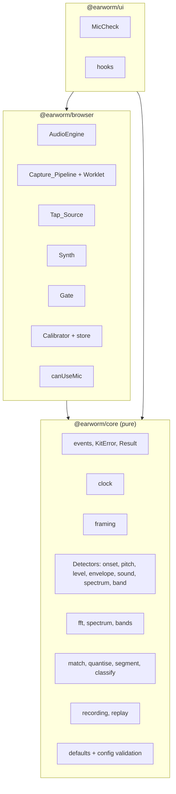
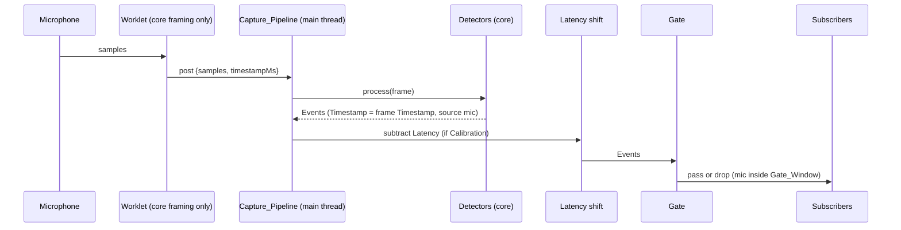

# Design Document

## Overview

The Earworm kit turns messy human input (knocks, claps, hums, whistles, taps) into timestamped, testable Events. It is the shared skeleton for three apps (Do As I Do, Ditdah, Loophole). The apps are out of scope. This document covers three npm workspace packages:

- `@earworm/core`: pure TypeScript. Event model, clock conversion, framing, the seven Detectors, FFT, bands, match, quantise, segment, duration classifier, Recording and Replay_Source. It runs in Node, on the main thread and (framing code only) in the AudioWorklet.
- `@earworm/browser`: Web Audio engine, Capture_Pipeline, Worklet, Tap_Source, Synth, Gate, Calibrator, `canUseMic`.
- `@earworm/ui`: React 19 `MicCheck` and hooks. React is a peer dependency.

### Design principles

1. One clock. Every time is a number of milliseconds on the Audio_Clock (`AudioContext.currentTime × 1000`). Core never reads a clock. Anything that needs "now" receives it as a parameter (a Timestamp, a Frame Timestamp, or an injected `now()` function in the browser package).
2. Core never throws. Core functions return `Result<T>` = `{ ok: true, value } | { ok: false, error: KitError }` (Req 16.13). Browser functions that can fail reject their Promise with a `KitError`.
3. Detectors are small deterministic state machines over Frames. The same Frame sequence from a fresh state yields identical Events.
4. Detection runs on the main thread. The Worklet only frames samples and posts `{samples, timestampMs}`, so main-thread delay moves arrival time and never the Timestamp (Req 2.10).
5. No dependency is added. FFT, YIN pitch estimation, WAV parsing for tests and the SVG-free UI are written in-repo. Existing dev dependencies (Vitest 5, fast-check 4, Playwright, `@vitejs/plugin-react`, dependency-cruiser) cover tooling.

### Research summary

- Web Audio gives `AudioWorkletGlobalScope.currentFrame` and `sampleRate`. A Timestamp of `currentFrame / sampleRate × 1000` is exact and independent of main-thread scheduling. This supports Req 2.10. A render quantum is 128 frames, about 2.7 ms at 48 kHz, so posting every quantum satisfies Req 2.3 (at least one Frame per 12 ms) with margin. The Worklet frame size is configurable: 128 (default, one quantum per Frame) or 512 (four quanta per Frame). A 512-sample Frame lasts 10.7 ms at 48 kHz and 11.6 ms at 44.1 kHz, so it still meets Req 2.3 at those rates, but not below 42,667 Hz.
- `getUserMedia` accepts `echoCancellation`, `noiseSuppression` and `autoGainControl` constraints. All three are set to `false` (Req 2.1).
- Pitch: YIN (de Cheveigné and Kawahara, 2002) uses the cumulative-mean-normalised difference function. It gives a built-in confidence (`1 − d'`) and a threshold rule that prefers the first dip, which avoids octave-below errors on harmonic tones. McLeod's NSDF is the alternative. YIN is chosen because its confidence maps directly to Req 4.3.
- Spectrum: a radix-2 iterative FFT on real input is enough for sizes 256 to 8192. The same FFT supplies the autocorrelation used by YIN, so one primitive serves two Detectors.
- Vite builds Worklets from `audioWorklet.addModule(new URL('./worklet.js', import.meta.url))`. Vite recognises the `new URL(..., import.meta.url)` pattern and emits the file as an asset (Req 2.12).

## Architecture



Allowed imports are exactly those in `.dependency-cruiser.js`: core imports nothing from browser, ui or React; browser imports core only; ui imports core and browser. Apps and tests import `@earworm/*` by name.

### Runtime data flow



The Tap_Source and Replay_Source implement the same `EventSource` interface and are wrapped by the same Gate, so a consumer does not branch on source type (Req 9.4). Order of stages on the mic path: detect, latency-correct, gate. Gate_Windows are in the Synth's scheduled time. Latency-corrected mic Events are also in scheduled time, so the two compare on the same basis.

### Key decisions

| Decision                                           | Rationale                                                               | Alternatives                                                                               |
| -------------------------------------------------- | ----------------------------------------------------------------------- | ------------------------------------------------------------------------------------------ |
| `Result<T>` in Core, rejected Promises in browser  | Matches Req 16.13 exactly                                               | Throwing: rejected by the requirement                                                      |
| Detector factories return `Result<Detector>`       | Req 17.3, 18.2, 19.14, 20.12 require constructors to return a Kit_Error | Throwing constructors: rejected                                                            |
| YIN with FFT autocorrelation                       | Confidence and octave behaviour match Req 4; FFT already exists         | Brute-force difference function: about 0.6 M multiply-adds per 128-sample Frame, too heavy |
| Gate and pure analysis code kept free of Web Audio | Property tests run them with fake inputs                                | Gate inside Synth: harder to test                                                          |
| Latency shift as a pure Core function `shiftEvent` | Round trip testable in Node                                             | Shift inside the pipeline only                                                             |

## Components and Interfaces

All signatures are TypeScript, strict mode, ESM.

### Core: shared types

```ts
export type Ms = number; // ms on the Audio_Clock
export interface KitError {
  code: string;
  message: string;
  setting?: string;
  field?: string;
}
export type Result<T> = { ok: true; value: T } | { ok: false; error: KitError };

export type EventSourceName = "mic" | "tap" | "replay" | (string & {});
export type Unsubscribe = () => void;
export interface EventSource {
  subscribe(listener: (e: EarwormEvent) => void): Unsubscribe;
}
export interface Frame {
  samples: Float32Array;
  timestamp: Ms;
  sampleRate: number;
}
export interface Detector {
  readonly name: string;
  process(frame: Frame): EarwormEvent[];
  reset(): void;
  flush?(): EarwormEvent[];
  setNoiseFloor?(db: number): void; // Onset, Pitch, Sound
}
```

`createEmitter(opts?: { onError?: (error: unknown, event: EarwormEvent) => void })` is a Core helper implementing `EventSource` plus `emit(e)`. It delivers synchronously in emit order and never reorders (Req 1.2). `emit` iterates a snapshot of listeners and re-checks each listener's `active` flag before every delivery, so an unsubscribe during dispatch stops delivery of Events not yet delivered to that subscriber and leaves the others untouched (Req 1.3, 1.4). A repeat unsubscribe is a no-op (Req 1.5).

A listener that throws is caught. Delivery continues to the remaining listeners, and the error goes to `onError`, so apps can route it. The default `onError` calls `console.error`. This is a design addition; the requirements do not cover it.

- `console.error` in this default is the only console use in Core. It does not break Core purity: it reads no clock, touches no DOM and imports nothing, and `console` exists in Node, on the main thread and in the AudioWorkletGlobalScope. The Worklet loads only framing code, so the emitter never runs there anyway.
- Core's `tsconfig.json` sets `lib: ["esnext"]` and `types: []`, so the global `console` is not declared for Core and a direct `console.error` call fails `npm run typecheck`. The default reads it through a narrowed `globalThis` lookup: `(globalThis as { console?: { error?: (...a: unknown[]) => void } }).console?.error?.(...)`. This type-checks without the DOM lib or Node types and does nothing if `console` is absent. No ambient declaration and no dependency are added.
- An `onError` that itself throws is caught and ignored, so `emit` never throws (Req 16.13).

### Core: clock, config, framing

- `secondsToMs(s): Result<Ms>`, `msToSeconds(ms): Result<number>`. Non-finite input gives `invalid-number` (Req 1.7, 1.8).
- `frames(samples, startMs, sampleRate, frameSize): Frame[]` is the single Framing_Function. Every Frame carries `samples`, `timestamp` and `sampleRate` (Frame glossary entry). The Worklet uses the incremental form `createFramer(frameSize, sampleRate)`, whose `push(quantum, currentFrame)` returns the Frames completed by that quantum with the same arithmetic. Frame `i` has Timestamp `startMs + (i × frameSize) / sampleRate × 1000`. The frame size is configurable: 128 is the default and 512 is supported. A WAV fixture framed with the same frame size as live capture (128 by default) gives the same Frames (Req 14.13).
- `frameIntervalMs(frameSize, sampleRate): Result<number>` returns `frameSize / sampleRate × 1000`, the Frame_Interval that apps pass to `segment` for Pitch_Event input (Frame_Interval glossary entry, Req 12.13).
- `DEFAULTS` holds the Default_Table plus the ranges stated in Requirements 5, 17, 18, 19, 20. `resolveConfig(spec, partial): Result<Resolved>` applies defaults for missing values (Req 16.16) and returns `invalid-config` with `setting` set for any out-of-range value (Req 16.17). Detectors expose `configure(partial): Result<void>` that leaves state and previous values unchanged on error.

### Core: Detectors

All Detectors set an Event's Timestamp to the Timestamp of the Frame being processed (Req 1.12). Earlier true times go in `startTime` or `endTime`. Every Detector ignores a Frame that is empty, holds a non-finite sample or has a Timestamp earlier than the previous valid Frame, and leaves its state unchanged.

| Detector | Factory                        | Output                     |
| -------- | ------------------------------ | -------------------------- |
| Onset    | `createOnsetDetector(cfg?)`    | `onset`                    |
| Pitch    | `createPitchDetector(cfg?)`    | `pitch`                    |
| Level    | `createLevelDetector(cfg?)`    | `level`                    |
| Envelope | `createEnvelopeDetector(cfg?)` | `envelope`                 |
| Sound    | `createSoundDetector(cfg?)`    | `sound-start`, `sound-end` |
| Spectrum | `createSpectrumDetector(cfg)`  | `spectrum`                 |
| Band     | `createBandDetector(cfg)`      | `band`                     |

Each factory returns `Result<Detector>`. Config values are those in the Default_Table or the owning requirement.

**Shared level helper.** `frameLevelDb(samples)` = `max(-120, 20 × log10(rms))`, exactly −120 for an all-zero Frame (Req 5.1, 5.5, 5.6).

**Rate limiter.** Level, Envelope, Spectrum and Band Detectors share `createRateGate(maxPerSecond)`. It allows an Event when the Frame Timestamp is at least `1000 / maxPerSecond` ms after the last emitted Event. Consecutive Events are therefore at least one interval apart, so any half-open 1000 ms window holds at most `maxPerSecond` Events.

**Onset_Detector.** Energy is the Frame level. State: `armed`, `lastOnsetTs: Ms | null`, and a short deque of `(timestamp, level)` over the attack window. With `thr = noiseFloor + threshold`:

1. The Frame fires when `level > thr`, `armed` is true, `level − min(level over the attack window) > threshold`, and either `lastOnsetTs === null` or `timestamp − lastOnsetTs ≥ refractory`.
2. Firing sets `armed = false` and `lastOnsetTs = timestamp`. A Frame with `level ≤ thr` sets `armed = true`.
3. `strength = min(1, (level − noiseFloor) / (threshold + 40))`. It is above 0 at a rise equal to the threshold and non-decreasing in the rise (Req 3.4).
4. Construction and `reset()` set `armed = true`, `lastOnsetTs = null` and clear the deque. With `lastOnsetTs === null` the refractory check is skipped, so no suppression applies until the first Onset_Event (Req 3.11). An explicit `null` is used instead of a sentinel such as `0` or `−Infinity`, so Frames with any finite Timestamp, including negative ones, behave the same.

**Pitch_Detector.** Keeps a 2048-sample Sample_History. Per Frame:

1. If the Frame level is at or below the Noise_Floor, emit nothing (Req 4.6).
2. Compute the YIN difference function by FFT autocorrelation over lags from `sampleRate/2000` to `sampleRate/80`. Take the first dip below an absolute threshold, refine with parabolic interpolation, then set `confidence = clamp(1 − d', 0, 1)`.
3. Emit only if `confidence ≥ threshold` and frequency lies in 80 to 2000 Hz. Compute `midi = clamp(round(69 + 12 log2(f/440)), 0, 127)` and `cents = 1200 log2(f / midiToHz(midi))`.

The history is zero-padded after the received samples until 2048 samples have arrived (Req 4.11). `reset()` clears it. `flush()` returns `[]` and keeps it (Req 4.12). Every valid Frame is appended to the history before step 1, so a quiet Frame still advances the window.

**Sample_History storage.** The Pitch, Spectrum and Band Detectors share `createSampleHistory(capacity)`, a ring buffer backed by one preallocated `Float32Array(capacity)` with a write index and a count. The capacity is 2048 for the Pitch_Detector and FFT_Size for the Spectrum and Band Detectors. `push(samples)` copies at most the last `capacity` samples of the Frame and overwrites the oldest entries in the same call, so the history never holds more than `capacity` samples, including while a Frame longer than the capacity is added (Req 4.14, 19.21). `snapshot(out)` writes the held samples oldest first into a reusable analysis buffer and zero-fills the rest. `clear()` sets the count to 0. Each of the three Detectors exposes a read-only `historyLength: number` equal to the count, which tests use to check the bound. It is a property of the Detector object, not a package export, so it does not change the export list checked by Req 16.15. An invalid Frame is rejected before `push`, so it leaves the history unchanged (Req 4.13, 19.16, 20.14).

**Level_Detector.** `level = frameLevelDb(samples)`, rate-limited (default 30/s).

**Envelope_Detector.** Smoothed level `s` starts at −120. For a valid Frame with `Δt = timestamp − previousTimestamp` (the first Frame uses its own duration `samples.length / sampleRate × 1000`): `τ = level > s ? attack : release`, `step = τ = 0 ? 1 : 1 − exp(−Δt/τ)`, `s += (level − s) × step`. `s` is clamped to [−120, 0]. Defaults: attack 10 ms, release 300 ms. `s` updates on every valid Frame. Emission is rate-limited.

**Sound_Detector.** States `idle`, `pending(startTime)`, `open(startTime, belowSince?)`. Level is compared with `noiseFloor + startThreshold` (default 12 dB) and `noiseFloor + endThreshold` (default 6 dB).

- `idle`: level above the start threshold gives `pending(t0 = timestamp)`.
- `pending`: level at or below the start threshold returns to `idle` with no Event. When `timestamp − t0 ≥ minHold` emit `sound-start {timestamp, startTime: t0, level}` and go to `open`.
- `open`: level below the end threshold sets `belowSince` if unset. When `timestamp − belowSince ≥ hangover` emit `sound-end {timestamp, endTime: belowSince, duration: belowSince − startTime}` and go to `idle`. Level at or above the end threshold clears `belowSince`.
- `flush()` on an `open` sound emits `sound-end` with Timestamp and `endTime` equal to the last valid Frame Timestamp, then goes to `idle`. `reset()` discards everything without Events.
- Events strictly alternate start, end by construction.

**Spectrum_Detector and Band_Detector.** Hold a Sample_History of `fftSize` samples in the shared ring buffer, so each holds at most FFT_Size samples at all times (Req 19.21). On a valid Frame they append, then analyse the history (zero-padded after the samples until full), subject to the rate limiter. `reset()` clears the history. `flush()` returns `[]`.

### Core: FFT, spectrum, bands

- `fft(re, im)` in-place radix-2. `windowCoefficients(name, size)` for hann, hamming, blackman, rectangular.
- `spectrum(samples, sampleRate, size, window = "hann"): Result<Float32Array>` (Req 19.1). Validation order: size, sample rate, window, samples. A single buffer shorter than `size` is zero-padded after the samples. A longer one uses its last `size` samples (Req 19.8). Bin 0 has magnitude `|X_0| / Σw` and every other bin `k` in `1..size/2−1` has `2|X_k| / Σw` (Req 19.7). Values are converted to dBFS, floored at −120 and capped at +6 in every bin, including bin 0 (Req 19.7, 19.12). With this scale a full-scale DC input reads 0 dBFS in bin 0 and a full-scale bin-centre sine reads 0 dBFS. Input is never modified.
- `bands(spectrum, sampleRate, size, window = "hann", bandList, unit = "dbfs"): Result<Record<string, number>>`. Validation covers the list (1 to 32 Bands, unique names), each Band (finite, `0 ≤ lowHz < highHz ≤ Nyquist`, non-empty string name), the unit, the window, and the spectrum length equal to `size/2`.
  - Bin `k` belongs to a Band when `lowHz ≤ k × sampleRate/size < highHz`. Bin `size/2` (Nyquist) is never present in a `size/2`-length spectrum.
  - Linear bin power follows the Parseval convention: `P_0 = (m_0 · w̄)²` and `P_k = m_k² · w̄² / 2` for `k ≥ 1`, where `m_k` is the linear magnitude from the dBFS value and `w̄` is the mean of the window. Band level = `10 log10(Σ P_k / mean(w²))`, floored at −120. For rectangular, hann and the others this makes a full-scale sine read −3.01 dBFS on the full band. The energy check of Req 19.11 and 20.6 applies only to Frames at −50 dBFS or above whose energy lies below 0.9 × Nyquist. Inside that scope the missing Nyquist bin and the −120 dBFS floor each add well under the 1e-3 relative tolerance.
  - `normalised` returns `(dBFS + 120) / 120`.
- `BAND_PRESET = [{low,0,250},{mid,250,2000},{high,2000,8000}]` as plain data. With a sample rate below 16,000 Hz `bands` returns `invalid-band` naming `high`.

### Core: analysis

```ts
type Pattern = readonly Ms[];
interface MatchResult {
  score: number;
  missed: number;
  extra: number;
  // index is a target hit index, 0 to target.length − 1; null only when the
  // target has no hits (Req 10.11, 10.14)
  largestError: { ms: number; index: number } | null;
  tempoRatio: number | null;
}
function match(target: Pattern, reply: Pattern): MatchResult; // never throws

interface BeatGrid {
  originMs: Ms;
  bpm: number;
  subdivision: number;
}
function quantise(t: Ms, grid: BeatGrid): Result<{ time: Ms; index: number }>;

type Mark = { start: Ms; duration: number };
type SegmentInput =
  | { kind: "pitch"; events: PitchEvent[]; gatedSpans?: Array<[Ms, Ms]> }
  | { kind: "sound"; events: Array<SoundStartEvent | SoundEndEvent> }
  | { kind: "tap"; events: Array<OnsetEvent | ReleaseEvent> };
function segment(input: SegmentInput, cfg?: SegmentConfig): Result<Mark[]>;

function classify(
  durations: number[],
  ratios: number[],
  opts?: { priorUnit?: number },
): Result<{
  unit: number;
  items: Array<{ classIndex: number; deviation: number }>;
}>;
```

**match.** Normalise each Pattern to start at 0 and, for equal counts, to the target's total duration. Equal counts: `e_i = |reply_i' − target_i|` in ms, `score = 1 − min(1, mean(e_i) / meanTargetInterval)`. `largestError` is the maximum `e_i` with its index. Unequal counts: align by dynamic programming on positions normalised to [0, 1]. The alignment is order-preserving, pairs exactly `min(n, m)` hits, and skips hits only from the longer Pattern, minimising the summed squared position error. Matched pairs give the equal-count term. `score = that term × matched / max(n, m)`, which is strictly below 1 whenever the counts differ. `missed = max(0, n − m)` and `extra = max(0, m − n)`, so a reply that is the target with hits only deleted, or only inserted, reports exactly the deleted and inserted counts (Req 10.5). A reply with both insertions and deletions cannot be told apart from timing errors; it reports the net difference. `tempoRatio` is reply total duration over target total duration. Degenerate inputs follow Req 10.6 to 10.8: fewer than 2 hits scores 1 for equal counts and 0 otherwise; non-finite or decreasing times score 0; zero total duration scores 1 only when both are zero-duration with equal counts. In those cases `tempoRatio` is `null`.

`largestError` follows these rules, checked in this order (Req 10.11 to 10.14):

1. The target has no hits: `largestError` is `null` (Req 10.14). This is the only case that returns `null`.
2. Either Pattern has fewer than 2 hits (Req 10.12), either Pattern holds a non-finite or decreasing time (Req 10.7), or the total duration of either Pattern is 0 ms (Req 10.8): no interval error is computed, and `largestError` is `{ ms: 0, index: 0 }`. Treating all three the same means Req 10.12 and 10.13 hold even when a short or identical Pattern is also invalid.
3. Otherwise `e_i` is computed for each matched pair, and `index` is the target index of the pair with the largest `e_i`. Ties go to the lowest target index. In the unequal-count case the alignment pairs each matched reply hit with one target hit, so `index` always names a target hit, from 0 to `target.length − 1` (Req 10.11).

A reply equal to the target gives a scale factor of exactly 1 and the same offsets, so every `e_i` is exactly 0 and the tie rule gives `{ ms: 0, index: 0 }` (Req 10.13).

**quantise.** `step = 60000 / (bpm × subdivision)`, `x = (t − originMs) / step`, `index = ceil(x − 0.5)` (a tie goes to the earlier position), `time = originMs + index × step`. Invalid tempo or subdivision gives `invalid-grid`; non-finite `t` gives `invalid-timestamp`.

**segment.**

- `pitch`: `cfg.frameInterval` is required and must be a positive finite number, otherwise `invalid-config` with `setting: "frameInterval"` and no Marks (Req 12.13). It equals the Frame duration, `frameSize / sampleRate × 1000` (see `frameIntervalMs`). Then check ascending order (`invalid-ordering` otherwise). Walk Events: end the run when `(t_next − t_prev) − frameInterval > maxGap`, or, with `pitchSplit` on, when the pitch difference exceeds the pitch-split threshold, or when a gated span begins between two Events. Then drop runs where any frequency lies outside `steadiness` cents of the run median. Then compute `start = first.timestamp` and `duration = last.timestamp − first.timestamp + frameInterval`. Then drop runs with `duration < minDuration`.
- `sound`: pair each `sound-start` with the next `sound-end`. Discard an end with no open start. Emit no Mark for a start with no end. Mark `start = startTime`, `duration = end.duration`. Apply `minDuration`. Return `invalid-ordering` when Events are not in ascending Timestamp order or an `endTime` precedes the matching `startTime`.
- `tap`: pair a `source: "tap"` Onset with the next Release. Mark `start = press.timestamp`, `duration = release.timestamp − press.timestamp`. Apply `minDuration`.

**classify.** For `n` durations and `k` ratios, candidate units are `d_i / r_c`. For each candidate, each duration takes the class with nearest nominal on a log scale (`d² ≤ nominal_c · nominal_{c+1}` assigns the lower class at an exact geometric midpoint). The cost is the sum of squared log errors. The lowest cost wins, with ties broken deterministically toward the smaller unit among candidates within 1e-12 relative cost. Deviation is `d / (unit × ratio[class])`. The minimum-error fit is the result (Req 13.5). When the minimum-error fit leaves class 0 empty or occupies fewer than two classes, and `priorUnit` is given, the classifier discards the fit, sets `unit = priorUnit` and assigns each duration its log-nearest class for that unit (Req 13.6). The prior unit is used and returned exactly as supplied: no refit, no rounding and no rescaling from the observed durations, so the returned `unit` is the same number as `opts.priorUnit` (Req 13.9, 13.10). Deviations are computed with that same value. With no prior and one cluster, the unit is the median duration and the class is 0. With no prior and class 0 empty, the minimum-error fit stands. A duration that is not positive and finite gives `invalid-duration`. Ratios that are empty, do not start at 1, or are not strictly increasing give `invalid-ratios`.

### Core: Recording and replay

```ts
interface Recording {
  version: number;
  events: EarwormEvent[];
}
function serialiseRecording(r: Recording): string; // total on valid Recordings
function parseRecording(text: string): Result<Recording>;
function createReplaySource(
  r: Recording,
): EventSource & { advance(nowMs: Ms): void };
```

`serialiseRecording` writes keys in a fixed order per Event type. A `Float32Array` becomes a plain number array and a Band_Event's values a plain object (Req 21.4). It writes `-0` as `0`. `parseRecording` returns `malformed-json`, `unsupported-version` (naming the version), or `invalid-recording` (naming the field). It restores Spectrum magnitudes as `Float32Array`, validates the new Event types (Req 21.6), and rebuilds Events with canonical key order, so `serialise(parse(serialise(r)))` equals `serialise(r)`.

`advance(now)` stable-sorts the Events once at construction. It emits each not-yet-emitted Event with `timestamp ≤ now` exactly once, ascending. A `now` smaller than the previous one emits nothing and changes nothing. Events keep their recorded source. Consumers call `flush()` on Detectors that have one at end of a Recording (Req 18.11); `flushDetectors(detectors): EarwormEvent[]` is the shared helper.

`shiftEvent(e, deltaMs): EarwormEvent` adds `deltaMs` to `timestamp`, and to `startTime` and `endTime` where present. It leaves `duration`, `data` and every other field unchanged. The pipeline calls it with `−Latency`.

### Browser package

```ts
interface AudioEngine {
  readonly context: BaseAudioContext;
  now(): Ms;
} // one shared context
function createAudioEngine(ctx?: BaseAudioContext): AudioEngine;
function canUseMic(env?: {
  navigator;
  AudioContext;
  AudioWorklet;
  isSecureContext;
}): boolean;

interface CapturePipeline extends EventSource {
  start(opts?: { detectors?: Detector[] }): Promise<void>;
  stop(): Promise<void>;
  readonly state: "stopped" | "starting" | "running" | "stopping";
}
function createCapturePipeline(
  engine,
  opts?: { gate?; calibration?: CalibrationStore; frameSize?: 128 | 512 },
): CapturePipeline;
```

**Capture_Pipeline.** `start` is idempotent while `starting` or `running` and returns the same Promise (Req 2.11). Order: request the stream with the three constraints off, resume the AudioContext if suspended (`audio-context-resume` on failure), add the Worklet module, connect, then process posted Frames. Failure paths release all tracks, close the Worklet and return to `stopped`, so a later `start` works (Req 2.4, 2.5, 2.9). Error mapping: `NotAllowedError` gives `permission-denied`; `NotFoundError` and `OverconstrainedError` give `no-device`. For each posted Frame it runs the Detector list (default Onset, Pitch, Level), sets `source: "mic"`, applies `shiftEvent(e, −latency)` when a Calibration exists, and emits. `stop` stops tracks, closes the Worklet, calls `flush()` on each Detector and emits the returned Events before resolving (Req 18.11). Envelope, Sound, Spectrum and Band are opt-in via `detectors` (Req 21.13).

**Worklet.** `worklet.ts` imports only `@earworm/core` framing code. The frame size arrives in `processorOptions` (default 128, 512 supported). Each `process()` call pushes the 128-sample quantum into `createFramer(frameSize, sampleRate)` and posts a transferred copy of each completed Frame with the Timestamp of its first sample, `currentFrame / sampleRate × 1000`. With 128 that is one post per quantum, about 375 per second at 48 kHz; with 512 it is one post per four quanta. It uses no DOM API.

**Tap_Source.** `createTapSource({ now, keyTarget, pointerTarget })` implements `EventSource` plus `start()`, `stop()` and `subscribeErrors(listener)`. State: `held: null | "key" | "pointer"`.

The state logic is a pure step function in `tap-model.ts`, which uses no DOM type and reads no clock:

```ts
type TapState = { held: null | "key" | "pointer"; stopped: boolean };
type TapInput =
  | { kind: "key-down"; repeat: boolean; inTextInput: boolean; now: Ms | null }
  | { kind: "key-up"; now: Ms | null }
  | { kind: "pointer-down"; onTarget: boolean; now: Ms | null }
  | { kind: "pointer-up"; now: Ms | null }
  | { kind: "blur"; now: Ms | null }
  | { kind: "stop"; now: Ms | null };
function tapStep(
  state: TapState,
  input: TapInput,
): {
  state: TapState;
  events: Array<OnsetEvent | ReleaseEvent>;
  error?: KitError; // clock-unavailable
  handled: boolean; // true when the DOM handler should call preventDefault
};
```

`tapStep` is exported from `@earworm/browser` so tests import it by package name. The DOM listeners translate each browser event into one `TapInput`, calling `now()` once (a throw becomes `null`), and apply `tapStep`. The rules below are the rules of `tapStep`. A space-bar Onset_Event needs `held === null`, and in a sequence of space-bar inputs only a space-bar key-up clears `held` after a space-bar press, so at least one release lies between any two space-bar Onset_Events (Req 9.12).

- `keydown` with `code === "Space"`, `repeat` false, `held === null`, and focus not in an `input`, `textarea`, `select` or content-editable element: emit `onset {strength: 1, source: "tap", timestamp: now()}` and set `held = "key"`. The handler calls `preventDefault` only when it handles the key.
- `pointerdown` on the tap target with `held === null`: same, with `held = "pointer"`.
- `keyup` or `pointerup` of the holding input: emit `release`, clear `held`. `blur`, `visibilitychange` to hidden and `stop()` while held emit `release` at that moment.
- If `now()` returns `null` or throws, drop the input and report `clock-unavailable` through `subscribeErrors`.
- `stop()` removes every listener.

**Synth.** `createSynth(engine, { gate })` with `schedule(voice, atMs, opts?: { frequency?, durationMs?, gain?, ungated? }): Promise<{ startMs, endMs }>`, `registerVoice(name, builder)`, `stop()`. Built-in Voices are built from `OscillatorNode`, `GainNode`, `BiquadFilterNode` and a generated noise `AudioBuffer`. No file is loaded. Validation runs before any node is created or the Gate is notified, in the pure function `validateScheduleRequest(voice, opts): Result<ValidatedRequest>`, which uses no Web Audio API. Checks in order: frequency 20 to 20,000 Hz and finite (`invalid-frequency`), duration 1 to 60,000 ms and finite (`invalid-duration`), gain a finite number from 0 to 1 inclusive (`invalid-gain`, Req 7.14). An omitted gain means 1. The function is exported from `@earworm/browser` so tests import it by package name. `schedule` rejects with the returned Kit_Error and returns before touching the context or the Gate. Start is `max(atMs, now())` and the resolved `startMs` is the actual start. Unless `ungated`, `gate.addWindow(start, end)` is called before `start()`. `stop()` ramps gain to 0 within 50 ms, stops sources, and notifies the Gate to cancel windows whose sounds have not started. Later calls reject with `synth-stopped`.

**Gate.**

```ts
interface Gate {
  addWindow(startMs: Ms, endMs: Ms): Result<{ id: number }>;
  cancelWindow(id: number): void;
  setMode(mode: "ignore-synth" | "off"): void;
  shouldPass(e: EarwormEvent): boolean;
  wrap(source: EventSource): EventSource;
}
function createGate(opts?: {
  tailMs?: number;
  outputLatencyMs?: number;
  hasCalibration?: () => boolean;
}): Result<Gate>;
```

A window is the closed interval `[start, end + tail (+ outputLatency when no Calibration)]`. Overlapping or touching windows behave as their union because `shouldPass` tests membership in any stored window. Storing raw windows with ids keeps `cancelWindow` correct after overlaps. `shouldPass` reads only `e.source`, `e.timestamp`, the windows and the mode. It drops only `source === "mic"` Events inside a window. Everything else passes, including `tap`, `replay` and unknown sources.

**Calibrator.** `createCalibrator({ engine, synth, source, store, detectors, wait? })`. `wait(ms): Promise<void>` defaults to a wait on the shared AudioContext clock; tests inject a fake.

```ts
interface CalibrationStore {
  get(): Calibration | null; // null = unset, Detectors use −60 dBFS
  set(c: Calibration): void; // replaces the whole object
  subscribe(listener: (c: Calibration | null) => void): Unsubscribe;
}
```

The store only ever holds a whole Calibration. Only two paths write it, each with a single `set` call of a complete `{ noiseFloorDb, latencyMs }` object: a `calibrate()` in which both measurements succeeded, and a `load(text)` that parsed successfully. The two `measure*` methods return their values and never write the store or call `setNoiseFloor`.

- `measureNoiseFloor(opts?)`: for the quiet period, collect Level_Events from `source`. The short-term level is the power-average of Level_Events inside a sliding 100 ms window. The floor is the highest short-term level. If it exceeds `maxQuietLevel` reject `room-too-loud`. With no Level_Events reject `calibration-failed`.
- `measureLatency(opts?)`: schedule 4 clicks 500 ms apart with `ungated: true`. Wait `timeout` (default 3000 ms) from the first click, then call the pure `medianLatency(scheduled, detected, maxMatchMs)`. It matches each detected Onset to the nearest scheduled click (each click at most once), rejects `calibration-failed` with fewer than 3 matches or a median outside 0 to 500 ms, and returns the median of `detected − scheduled`.
- `calibrate()` runs both measurements into local variables and calls `store.set({ noiseFloorDb, latencyMs })` only when both succeed. If either fails (Req 6.5, 6.6, 6.10, 6.11), the local values are dropped, the store is not written, and the promise rejects with the Kit_Error. A Noise_Floor measured before a failed latency step is therefore never stored (Req 6.13).
- `load(text)` calls `parseCalibration(text)` and, on success, `store.set` with the parsed object. On failure it rejects `invalid-calibration` and writes nothing (Req 6.9). A loaded Calibration counts as the previous Calibration for later failures (Req 6.13).
- `serialiseCalibration(c): string` and `parseCalibration(text): Result<Calibration>` (`invalid-calibration`). Persistence is the app's job: Browser code never touches `localStorage` (Req 16.14).
- On every `store.set`, and only then, the Calibrator calls `setNoiseFloor(db)` on every Detector in `detectors` that has it and the Capture_Pipeline reads the new Latency. If no Calibration was ever set, a failure leaves the store `null`, no `setNoiseFloor` call happens, and the Detectors keep the default of −60 dBFS (Req 6.12, 6.14).

### UI package

- Hooks (built on `useSyncExternalStore`, each unsubscribing on unmount): `useEvents(source, { limit })`, `useInputLevel(source): number`, `useCalibrationState(store): CalibrationState`, `useEnvelopeLevel(source): number | null`, `useSpectrum(source): Float32Array | null`, `useBands(source): Record<string, number> | null`.
- Pure helper `latestOfType(events, type)` backs the three nullable hooks.
- `MicCheck({ capture, tap, calibrator, store, onSourceChange })`:
  - `canUseMic()` false: render only the tap-mode control and call no microphone API.
  - Permission state: "prompt" initially, read from `navigator.permissions.query({ name: "microphone" })` when available (this does not prompt), updated to "granted" or "denied" by the result of `capture.start()`.
  - A button starts capture, so permission is requested only after a user action. Copy explains why the microphone is needed.
  - Input level is `(clamp(dBFS, −60, 0) + 60) / 60` from Level_Events (30 per second, above the 10 Hz minimum).
  - Calibrate control runs `calibrator.calibrate()`. On rejection show the Kit_Error code, set state "failed" and keep the stored Calibration.
  - "denied" disables calibrate and shows tap mode. Activating tap mode calls `onSourceChange(tap)` after `tap.start()`.
  - Native `<button>` controls with accessible names give Tab, Enter and Space behaviour for free.
  - Stable `data-testid`: `mic-permission`, `mic-level`, `mic-calibration-state`, `mic-enable`, `mic-calibrate`, `mic-tap-mode`, `mic-error`, `mic-explanation`.

## Data Models

```ts
interface BaseEvent {
  type: string;
  timestamp: Ms;
  source: EventSourceName;
}
interface OnsetEvent extends BaseEvent {
  type: "onset";
  strength: number;
}
interface PitchEvent extends BaseEvent {
  type: "pitch";
  frequency: number;
  midi: number;
  cents: number;
  confidence: number;
}
interface LevelEvent extends BaseEvent {
  type: "level";
  level: number;
}
interface ReleaseEvent extends BaseEvent {
  type: "release";
}
interface EnvelopeEvent extends BaseEvent {
  type: "envelope";
  level: number;
}
interface SoundStartEvent extends BaseEvent {
  type: "sound-start";
  startTime: Ms;
  level: number;
}
interface SoundEndEvent extends BaseEvent {
  type: "sound-end";
  endTime: Ms;
  duration: number;
}
interface SpectrumEvent extends BaseEvent {
  type: "spectrum";
  sampleRate: number;
  fftSize: number;
  magnitudes: Float32Array;
}
interface BandEvent extends BaseEvent {
  type: "band";
  unit: "dbfs" | "normalised";
  values: Record<string, number>;
}
interface CustomEvent extends BaseEvent {
  type: `x-${string}`;
  data: Record<string, unknown>;
}
type EarwormEvent =
  | OnsetEvent
  | PitchEvent
  | LevelEvent
  | ReleaseEvent
  | EnvelopeEvent
  | SoundStartEvent
  | SoundEndEvent
  | SpectrumEvent
  | BandEvent
  | CustomEvent;

interface Band {
  name: string;
  lowHz: number;
  highHz: number;
}
interface Calibration {
  noiseFloorDb: number;
  latencyMs: number;
}
type CalibrationState =
  | "uncalibrated"
  | "calibrating"
  | "calibrated"
  | "failed";
interface Recording {
  version: 1;
  events: EarwormEvent[];
}
```

Recording JSON shape (version 1): `{"version":1,"events":[{"type":"onset","timestamp":1200,"source":"mic","strength":0.6}, ...]}`. A Spectrum_Event's `magnitudes` is a plain array of `fftSize / 2` finite numbers.

Kit_Error codes: `permission-denied`, `no-device`, `audio-context-resume`, `clock-unavailable`, `invalid-number`, `invalid-timestamp`, `invalid-grid`, `invalid-ordering`, `invalid-duration`, `invalid-ratios`, `invalid-frequency`, `invalid-gain`, `invalid-gate-window`, `invalid-config`, `invalid-fft-size`, `invalid-sample-rate`, `invalid-window`, `invalid-samples`, `invalid-band`, `invalid-unit`, `invalid-spectrum`, `invalid-calibration`, `calibration-failed`, `room-too-loud`, `synth-stopped`, `malformed-json`, `unsupported-version`, `invalid-recording`.

Fixture manifest (`fixtures/recorded/manifest.json`): `{ fixtures: [{ name, file, kind, expected: { onsets?: [{t}], pitches?: [...], envelope?: [{t, level}], sounds?: [{startTime, endTime}], bands?: [{t, values}], spectrum?: [{t, bin}] } }] }`. No magnitudes are stored (Req 21.12).

## Assumptions and Open Issues in the Requirements

Nothing below changes a requirement. Each item records how the design reads it. Items marked **Resolved** were settled by an update to requirements.md; the design body now follows the cited criteria, and the numbers are kept so references stay stable.

**Conflicts and gaps**

1. **Resolved by Req 13.5 and 13.6 (unit recovery).** The minimum-error fit is accepted. Req 13.5 applies only when at least two classes occur, including class 0, and Property 36 generates such sets. When the fit leaves class 0 empty and a prior unit is supplied, the classifier uses the prior unit (Req 13.6, Property 56).
2. **Resolved by Req 1.11 and 21.10 (Custom_Events).** Custom_Events keep `type`, `source` and `data` unchanged. The Latency shift and the Gate apply to them like any other Event (Property 4).
3. **Resolved by Req 19.11 and 20.6 (energy checks).** The checks apply only to Frames at −50 dBFS or above whose energy lies below 0.9 × Nyquist. The spectrum has `size/2` bins, so the Nyquist bin is absent and Req 20.5's "Nyquist bin when it exists" never applies. Generators for Properties 51 and 53 stay inside that scope (see Testing Strategy, Generators).
4. **Resolved by Req 19.7 and 19.12 (DC bin).** Bin 0 is scaled by `1/Σw`, every other bin by `2/Σw`, and every bin is capped at +6 dBFS.
5. **Req 20.6 (power correction).** "Divided by the mean of the squared window values" is read in the Parseval convention (bin power `(|X|/N)²`, doubled for non-DC bins), converted from the dBFS magnitudes using the window mean. That reading meets the stated outcomes (sine reads −3.01 dBFS, full band reads the mean square).
6. **Resolved by Req 10.5 (count mismatch).** A reply that is the target with hits inserted or deleted scores strictly below 1, with `missed` and `extra` equal to the deleted and inserted counts. The alignment pairs exactly `min(n, m)` hits (see Core: analysis, match), and Property 26 generates replies with only insertions or only deletions.
7. **Req 3.1 (onset rule).** "Rises within the attack window" is implemented as a rise of more than the threshold over the minimum level in the attack window, together with the level exceeding `Noise_Floor + threshold`. Re-arming needs the level to fall to or below the threshold. A loud sustained sound followed by a clap produces no second Onset. This is tuned against the recorded fixtures.
8. **Req 1.2 with Latency and mixed sources.** Subtracting a constant keeps mic Events ordered. Merging mic and tap into one stream is not ordered by the kit. Each source is ordered; apps that merge sources sort themselves.
9. **Req 12.12.** The Segmenter is pure and cannot see the Gate, so it takes optional `gatedSpans`. A Mark ends at the last Pitch_Event before a span begins.
10. **Req 12.10 versus 12.6.** Order of steps: split on gap, split on pitch (if enabled), discard unsteady runs, then apply the minimum duration. With splitting off, a wide vibrato run is discarded whole.
11. **Req 12.11 (tap minimum duration).** The minimum duration is applied to tap and sound Marks as well as pitch Marks.
12. **Req 18.3 with the Gate.** A Sound_Start_Event carries the confirmation Timestamp, so the Gate tests that time and not `startTime`. A sound that began just before a Gate_Window can lose its start Event and keep its end, or the reverse. The Segmenter drops orphans (Req 18.21).

**Assumptions**

13. **Resolved by the Frame glossary entry.** A Frame carries `sampleRate`.
14. **Resolved by the Frame_Interval glossary entry and Req 12.13.** `SegmentConfig.frameInterval` is required for `pitch` input and equals the Frame duration (`frameSize / sampleRate × 1000`). A missing or non-positive or non-finite value gives `invalid-config` (Property 33).
15. Envelope first-Frame Δt is the Frame's own duration. Without it the smoothed level could not leave −120 on the first Frame.
16. "Short-term level" for the Noise_Floor (Req 6.1) is a 100 ms power average of Level_Events.
17. A valid Calibration has `noiseFloorDb` in −120 to 0 and `latencyMs` in 0 to 500.
18. Level meter scale in MicCheck maps −60 to 0 dBFS onto 0 to 1.
19. The `Pattern` type is a list of Timestamps. Interval lists convert through a helper.
20. "Any 1000 ms window" in rate limits means a half-open window `[t, t + 1000)`.
21. `serialiseRecording` and `parseRecording` accept Events in any order. `createReplaySource` stable-sorts them.
22. `useCalibrationState` reads the Calibration store, not the Event_Source, because the Event_Source carries no Calibration (Req 15.9).
23. `quantise` returns `invalid-grid` for a non-positive or non-integer `subdivision` as well as for a bad tempo.
24. **Decided: tooling.** These are recorded here and implemented by the tasks, with no new dependency. See Testing Strategy, Tooling.
25. The Worklet frame size defaults to 128 and may be set to 512. A 512-sample Frame meets Req 2.3 only at sample rates of 42,667 Hz or more (44.1 and 48 kHz qualify).
26. **Req 10.12 to 10.14 with Req 10.7 and 10.8.** The requirements do not state `largestError` for invalid Patterns (10.7) or zero total duration (10.8) when the target has hits. The design returns `{ ms: 0, index: 0 }` for both, following the "no interval error exists" convention of Req 10.12. Returning `null` for invalid Patterns was rejected because it would break Req 10.12 for an invalid single-hit Pattern and Req 10.13 for a reply equal to an invalid target. `null` is reserved for an empty target (Req 10.14). The interval error is the per-hit position error after normalisation, as before, and its index names a target hit.
27. **Req 6.13.** "Previous Calibration" means the store's value before the attempt began: the last `calibrate()` that completed in full or the last successful `load(text)`, whichever came later. `measureNoiseFloor` and `measureLatency` are measurements, not attempts that store, so they never change it.
28. **Req 9.12.** "Space bar release" means a space-bar key-up input. The property is stated over sequences of space-bar inputs only (key down, auto-repeat key down, key up), from any starting hold state, as the criterion says. Pointer, blur and stop inputs are covered by Property 24.
29. **Req 13.9 and 13.10.** "Exactly as supplied" means the returned `unit` is the same number (`Object.is`) as `opts.priorUnit`. The requirements do not say how to treat a prior unit that is not a positive finite number; the classifier ignores such a prior and behaves as if none was given.
30. **Req 19.22 and 20.23.** These criteria scope the performance tests. Calls with invalid inputs return a Kit_Error early and are not timed.

## Correctness Properties

In this section, each correctness property is a characteristic or behavior that should hold true across all valid executions of the system. It is a formal statement about what the system should do, and it bridges human-readable specifications and machine-verifiable correctness guarantees.

Reflection on the prework merged these groups: the five determinism criteria (3.5, 17.12, 18.16, 19.17, 20.15) into Property 5; the seven invalid-Frame criteria into Property 6; the four rate-limit criteria into Property 7; the Gate criteria (8.1, 8.3 to 8.9, 9.5, 21.1) into Property 21; and the history criteria (4.11, 4.12, 19.19, 19.20, 20.22) into Property 31. The click-train property (3.9) subsumes the single-onset rule of 3.1. For the later criteria: the history bounds (4.14, 19.21) share Property 58; gain validation (7.14) extends Property 23; the exact prior unit (13.9, 13.10) extends Property 56; the two rollback criteria (6.13, 6.14) share Property 59; and the four `largestError` criteria (10.11 to 10.14) share Property 61. Req 19.22 and 20.23 scope the performance tests and have no property.

### Property 1: Time conversion round trip

For any finite number of seconds from 0 to 1e6, converting to a Timestamp and back yields a value within 1e-9 s of the original, and converting any Timestamp to seconds and back yields the original within 1e-6 ms.

**Validates: Requirements 1.7, 1.9**

### Property 2: Non-finite conversion input is rejected

For any value that is NaN, Infinity or -Infinity, both conversion functions return `{ ok: false }` with code `invalid-number` and no value.

**Validates: Requirements 1.8**

### Property 3: Event source delivery model

For any sequence of subscribe, unsubscribe (including repeated and during-dispatch unsubscribes) and emit operations, each subscriber receives exactly the Events emitted while it was subscribed, in emit order, receives none after it unsubscribes, and no unsubscribe call affects another subscriber or throws. For any subset of subscribers whose callbacks throw, every other subscriber still receives every Event, `emit` does not throw, and `onError` is called once per thrown error.

**Validates: Requirements 1.2, 1.3, 1.4, 1.5**

### Property 4: Custom Events keep their type and data

For any Custom_Event (type beginning `x-`) passed through `shiftEvent`, the Gate, `serialiseRecording` then `parseRecording`, and the Replay_Source, every Event that comes out has the same `type`, `source` and deep-equal `data`, and its Timestamp changes only by the Latency shift. The Gate drops a Custom_Event exactly when it would drop any other Event with the same source and Timestamp.

**Validates: Requirements 1.11, 21.10**

### Property 5: Detector determinism and reset equivalence

For any Detector, configuration and Frame sequence, processing the sequence from a fresh state twice yields identical Events (Timestamps, fields and magnitudes), and processing it after `reset()` yields the same Events as a freshly built Detector.

**Validates: Requirements 3.5, 17.12, 18.16, 19.17, 20.15**

### Property 6: Invalid Frames are ignored

For any Detector and any Frame sequence into which empty Frames, Frames with NaN or infinite samples and Frames with a Timestamp earlier than the previous valid Frame are inserted, the emitted Events equal those from the sequence with the invalid Frames removed.

**Validates: Requirements 3.8, 4.13, 5.8, 17.8, 18.14, 19.16, 20.14**

### Property 7: Rate limits hold

For any Frame sequence and any configured maximum rate from 1 to 100, the Level, Envelope, Spectrum and Band Detectors emit at most that many Events in any half-open 1000 ms window of Event Timestamps. For the Envelope Detector, the smoothed level still equals that of an unlimited run.

**Validates: Requirements 5.2, 17.5, 19.15, 20.13**

### Property 8: Detector Events are stamped with the Frame Timestamp

For any Detector and valid Frame sequence, every Event returned by `process(frame)` has the Timestamp of that Frame, and every Event returned by `flush()` has the Timestamp of the last valid Frame. Sound_Start_Event and Sound_End_Event also carry `startTime` and `endTime` no later than their Timestamp. Concatenating all Detector outputs in return order is non-decreasing in Timestamp.

**Validates: Requirements 1.12, 5.3, 17.6, 18.3, 18.4, 18.10**

### Property 9: Onset refractory spacing and strength

For any Frame sequence and any refractory period from 0 to 1000 ms, consecutive Onset_Events are at least the refractory period apart. Every `strength` lies in (0, 1], and for any two rises above the Noise_Floor, the larger rise never yields the smaller strength.

**Validates: Requirements 3.2, 3.4, 3.6**

### Property 10: No Onset at or below the threshold

For any Frame sequence whose levels never exceed `Noise_Floor + threshold`, the Onset_Detector emits no Event.

**Validates: Requirements 3.3**

### Property 11: Click trains yield one Onset per click

For any train of 1 to 12 clicks, 120 to 1000 ms apart, at −30 to −6 dBFS over low noise, framed at 128 to 512 samples, the Onset_Detector emits exactly one Onset_Event per click, each within 12 ms of the true click time.

**Validates: Requirements 3.1, 3.9**

### Property 12: Pitch Events are well formed and confident

For any Frame sequence, every Pitch_Event has frequency from 80 to 2000 Hz, an integer `midi` from 0 to 127, `cents` from −50 to +50, `confidence` from 0 to 1 and at least the configured threshold, and its Timestamp equals the Frame Timestamp.

**Validates: Requirements 4.1, 4.2, 4.3, 4.4, 4.7**

### Property 13: Sine pitch accuracy

For any sine tone from 80 to 2000 Hz above the Noise_Floor supplied for at least 10 consecutive Frames, every Pitch_Event after the first 5 Frames has a frequency within 10 cents of the true frequency.

**Validates: Requirements 4.5**

### Property 14: Harmonic tones report the fundamental

For any harmonic tone with a fundamental from 80 to 1000 Hz and at least 4 harmonics, every Pitch_Event reports the fundamental within 20 cents, never an octave above or below.

**Validates: Requirements 4.9**

### Property 15: Silence and noise produce no Pitch

For any all-zero input, any input below the Noise_Floor, and any white noise above the Noise_Floor, the Pitch_Detector emits no Event.

**Validates: Requirements 4.6, 4.10**

### Property 16: Level formula and bounds

For any Frame with samples from −1 to 1, the Level_Detector reports `max(−120, 20·log10(rms))`, which lies in [−120, 0]. An all-zero Frame reads exactly −120, and a full-scale sine reads −3.01 dBFS within 0.5 dB.

**Validates: Requirements 5.1, 5.4, 5.5, 5.6, 5.7**

### Property 17: Noise floor measurement

For any list of timed Level_Events, the stored Noise_Floor equals the highest 100 ms power-average level, and when that level exceeds the maximum quiet level the measurement is rejected with `room-too-loud` and no value is produced.

**Validates: Requirements 6.1, 6.6**

### Property 18: Median latency and failure rules

For any four scheduled click times and any detected times formed from the scheduled times plus offsets, `medianLatency` returns the median of the matched differences. It returns `calibration-failed` when fewer than 3 clicks match or the median lies outside 0 to 500 ms, and it is unchanged by extra unmatched detections far from any click.

**Validates: Requirements 6.3, 6.10, 6.11**

### Property 19: Latency correction

For any Event and any Latency, `shiftEvent(e, −latency)` lowers `timestamp`, and `startTime` or `endTime` where present, by exactly the Latency. It leaves `duration` and all other fields unchanged, and shifting by `−latency` then `+latency` restores the original Event.

**Validates: Requirements 6.4, 21.3**

### Property 20: Calibration serialisation

For any valid Calibration, parsing its serialisation yields an equal Calibration. For any text that does not parse to a valid Calibration, `parseCalibration` returns `invalid-calibration`.

**Validates: Requirements 6.7, 6.8, 6.9**

### Property 21: Gate filtering model

For any list of Events (any source, including unknown sources, and any Event type), any set of Gate_Windows (including overlapping and touching ones), any tail from 0 to 5000 ms, any output latency and any mode, the Gate passes exactly the Events that are not `source: "mic"` or whose Timestamp lies outside every closed window `[start, end + tail (+ output latency without Calibration)]`, in the original order. Mode `off` passes every Event, and an empty input yields an empty output. The result does not depend on which Event_Source delivered the Event.

**Validates: Requirements 8.1, 8.3, 8.4, 8.5, 8.6, 8.7, 8.8, 8.9, 9.5, 21.1**

### Property 22: Invalid Gate windows are rejected

For any notification with an end before its start, a non-finite time, or a tail that is negative, non-finite or above 5000 ms, `addWindow` returns `invalid-gate-window` and the set of Gate_Windows is unchanged.

**Validates: Requirements 8.2**

### Property 23: Synth input validation

For any tone request with a non-finite or out-of-range frequency (outside 20 to 20,000 Hz) or a non-finite or out-of-range duration (outside 1 to 60,000 ms), and for any request of any Voice with a gain that is not a finite number from 0 to 1 inclusive, `validateScheduleRequest` returns `invalid-frequency`, `invalid-duration` or `invalid-gain` (in that check order), and `schedule` rejects with that Kit_Error, creates no sound and notifies the Gate zero times. For any finite gain from 0 to 1 with a valid frequency and duration, validation succeeds.

**Validates: Requirements 7.2, 7.6, 7.14**

### Property 24: Tap Source follows the press model

For any sequence of space-key down, key up, auto-repeat, pointer down and up on the target, blur, text-input focus and stop actions, with any injected clock, the emitted Events equal those of a reference model. Presses emit one Onset with strength 1 and source `tap` at the clock time, releases emit one Release, auto-repeat and a second input while one is held emit nothing, text-input focus and post-stop input emit nothing, and blur or stop while held emit a Release.

**Validates: Requirements 9.1, 9.2, 9.3, 9.6, 9.7, 9.9, 9.10, 9.11**

### Property 25: Match score range, identity, shift and scale invariance

For any target Pattern with two or more hits and any reply Pattern, the score is finite and in [0, 1]. A reply equal to the target scores 1. Shifting the reply by any finite offset leaves the score unchanged. Multiplying all reply intervals by any factor above 0 changes the score by at most 1e-9 and gives `tempoRatio` equal to the factor.

**Validates: Requirements 10.1, 10.2, 10.3, 10.4, 10.10**

### Property 26: Match penalises missing and extra hits

For any target Pattern with two or more hits and any reply that is the target with one or more hits inserted, or with one or more hits deleted (leaving at least two), the score is strictly below 1, `missed` equals the number of deleted hits and `extra` equals the number of inserted hits. The generator applies only insertions or only deletions to one reply.

**Validates: Requirements 10.5, 10.10**

### Property 27: Match degenerate inputs and purity

For any Patterns with fewer than 2 hits, non-finite or decreasing times, or zero total duration, `match` returns the score defined by the requirements and does not throw. For any inputs, two calls return equal results and the input arrays are unchanged.

**Validates: Requirements 10.6, 10.7, 10.8, 10.9**

### Property 28: Quantise nearest-position model

For any valid Beat_Grid and finite Timestamp, `quantise` returns the integer index `ceil((t − origin)/step − 0.5)` and `time = origin + index × step`, the distance to `t` is at most half a step (within floating tolerance), and an exact midpoint goes to the earlier position.

**Validates: Requirements 11.1, 11.2, 11.3, 11.5**

### Property 29: Quantise idempotence and monotonicity

For any valid Beat_Grid, quantising a snapped Timestamp returns the same time and index, and quantising a non-decreasing list of Timestamps yields non-decreasing indices.

**Validates: Requirements 11.4, 11.6**

### Property 30: Quantise rejects invalid input

For any Beat_Grid with a zero, negative, NaN or infinite tempo, `quantise` returns `invalid-grid`. For any NaN or infinite Timestamp it returns `invalid-timestamp`. Neither returns a time or index.

**Validates: Requirements 11.7, 11.8**

### Property 31: Sample history semantics

For any sample stream cut into Frames in any way, the Spectrum_Detector's magnitudes at each emitted Event equal `spectrum` of the most recent FFT_Size samples seen so far, zero-padded after the samples until FFT_Size samples have arrived. The same holds for the Band_Detector with `bands`, and for the Pitch_Detector's 2048-sample window. After `reset()` the history is empty. `flush()` returns no Events and does not change later output.

**Validates: Requirements 4.11, 4.12, 19.19, 19.20, 20.22**

### Property 32: Pitch segmentation matches the reference

For any ascending list of Pitch_Events, any maximum gap, minimum duration, Frame_Interval, steadiness tolerance and pitch-split setting, `segment` equals a naive reference implementation. Marks have `start` equal to the first Event Timestamp, `duration` equal to last minus first plus Frame_Interval, duration at least the minimum and above 0, ascending starts, and no overlap. An empty list gives no Marks.

**Validates: Requirements 12.1, 12.2, 12.3, 12.4, 12.5, 12.6, 12.7, 12.8, 12.10**

### Property 33: Segmentation of gated spans and ordering errors

For any Pitch_Event list and any gated span that begins inside a tone, the Mark ends at the last Pitch_Event before the span. For any list that is not in ascending order, `segment` returns `invalid-ordering` and no Marks. For any Pitch_Event input whose Frame_Interval is missing, zero, negative, NaN or infinite, `segment` returns `invalid-config` naming `frameInterval` and no Marks.

**Validates: Requirements 12.9, 12.12, 12.13**

### Property 34: Sound and tap pairs become Marks

For any valid sequence of Sound_Start and Sound_End pairs, or tap press and Release pairs, with orphan Events inserted, `segment` returns one Mark per complete pair with `start` and `duration` taken from `startTime` and `duration` (or press and release), drops pairs shorter than the minimum duration, keeps pairs equal to it, ignores orphan ends and unmatched starts, and returns Marks with positive durations in ascending order without overlap. Out-of-order Events or an `endTime` before its `startTime` give `invalid-ordering`.

**Validates: Requirements 12.11, 18.20, 18.21, 18.22, 18.23, 18.24**

### Property 35: Duration classifier invariances

For any durations and Ratio_Set, with no prior unit, multiplying all durations by a factor from 0.1 to 10 leaves classes unchanged, Deviations within 0.001 and the unit scaled within 0.1%. Reordering the input permutes the output the same way.

**Validates: Requirements 13.3, 13.4**

### Property 36: Duration classifier correctness

For any list of 1 to 1000 durations and valid Ratio_Set, the result has one entry per duration in input order, each class is the log-nearest class to the duration for the returned unit (a geometric midpoint goes to the lower class), and each Deviation equals `d / (unit × ratio[class])`. For any durations that are `unit × ratio` perturbed by up to ±20%, where at least two classes occur and class 0 is one of them, the minimum-error fit returns the unperturbed classes. The generator always places at least one duration in class 0 and at least one in another class.

**Validates: Requirements 13.1, 13.2, 13.5**

### Property 37: Duration classifier rejects invalid input

For any duration that is not positive and finite, the classifier returns `invalid-duration`. For any Ratio_Set that is empty, does not start at 1 or is not strictly increasing, it returns `invalid-ratios`.

**Validates: Requirements 13.7, 13.8**

### Property 38: Recording round trip

For any valid Recording, including Envelope, Sound, Spectrum, Band and Custom Events, `parseRecording(serialiseRecording(r))` deep-equals `r` (Float32 magnitudes exactly, other numbers within 1e-9), serialising the parsed value gives text identical to the first serialisation, and the JSON holds no typed array.

**Validates: Requirements 14.2, 14.3, 14.7, 14.8, 21.4, 21.5, 21.7, 21.8**

### Property 39: Recording parser rejects invalid input

For any text that is not JSON, the parser returns `malformed-json`. For any valid JSON with an unsupported version it returns `unsupported-version` naming that version. For any text with a supported version but a missing Event list, an invalid Event, a Spectrum_Event with the wrong magnitude length or a non-finite entry, a Sound_Start_Event with a bad `startTime`, a Sound_End_Event with a negative or non-finite `duration` or bad `endTime`, or a Band_Event missing a Band value, it returns `invalid-recording` naming the field. No Recording is returned in any case.

**Validates: Requirements 14.4, 14.5, 14.6, 21.6**

### Property 40: Replay emits each Event once in order

For any Recording and any sequence of `advance(t)` calls, the Replay_Source emits exactly the Events with Timestamp at most the largest `t` so far, each once, in ascending Timestamp order, with fields and source unchanged. An advance to an earlier time emits nothing and does not change the set of remaining Events.

**Validates: Requirements 14.10, 14.11, 14.15, 21.2, 21.9**

### Property 41: Framing preserves samples and time

For any sample array, start time, sample rate and frame size, the Frames concatenate back to the input samples, every Frame carries that sample rate, and Frame `i` has Timestamp `start + i × frameSize / sampleRate × 1000`. Framing is deterministic. For frame sizes 128 and 512, pushing the same samples into `createFramer` in 128-sample quanta yields the same complete Frames as `frames`.

**Validates: Requirements 14.13, 2.2**

### Property 42: canUseMic truth table

For any combination of presence of `getUserMedia`, `AudioContext`, `AudioWorklet` and a secure context, `canUseMic` returns true exactly when all four are present.

**Validates: Requirements 15.1**

### Property 43: Latest-value store

For any sequence of Events of mixed types and sources, the latest Envelope level, Spectrum magnitudes and Band values are those of the last matching Event, `null` before any matching Event, and unchanged by non-matching Events such as those from the Tap_Source.

**Validates: Requirements 21.14, 21.16**

### Property 44: Configuration validation

For any setting in the Default_Table or in Requirements 5, 17, 18, 19 and 20, an omitted value resolves to its default, and a value outside its allowed range returns `invalid-config` naming the setting while leaving the previous configuration unchanged.

**Validates: Requirements 16.16, 16.17, 17.2, 17.3, 18.2, 19.14, 20.12**

### Property 45: Envelope matches the recurrence

For any valid Frame sequence, attack and release from 0 to 10,000 ms, the Envelope level follows `s += (level − s) × (1 − exp(−Δt/τ))` with `τ` chosen by direction, starts at −120, lies in [−120, 0], and never exceeds the highest Frame level so far. An all-zero input moves toward −120 and never goes below it.

**Validates: Requirements 17.1, 17.2, 17.4, 17.7, 17.9**

### Property 46: Envelope convergence and asymmetry

For any constant sine with a Frame level from −60 to −3 dBFS, Frames of 128 to 1024 samples and attack from 1 to 1000 ms, the level is within 0.5 dB of the Frame level after 6 attack time constants. For any step of D dB (6 to 60) with attack shorter than release, half of an upward step takes less time than half of a downward step.

**Validates: Requirements 17.10, 17.11**

### Property 47: Sound Detector matches the state machine model

For any Frame sequence and valid configuration, the Sound_Detector's Events equal a reference state machine: start after Min_Hold above the start threshold, end after Hangover below the end threshold, nothing in between, and cancellation of short runs. Events alternate strictly start, end beginning with a start. Every `duration` is finite and at least Min_Hold. `flush()` on an open sound returns one end Event and leaves nothing open, `flush()` with none open returns nothing, and `reset()` discards state with no Events.

**Validates: Requirements 18.1, 18.3, 18.4, 18.5, 18.6, 18.7, 18.8, 18.9, 18.10, 18.12**

### Property 48: Sound bursts are located

For any tone bursts of 100 to 2000 ms at −40 to −6 dBFS, separated by at least Hangover plus 100 ms, over noise at least 20 dB below the burst, at 44.1 or 48 kHz and Frames of 128 to 512 samples, the Sound_Detector emits one start and one end per burst. `startTime` is within 15 ms and `endTime` within 30 ms of the truth. The start Timestamp lies in `[startTime + MinHold, startTime + MinHold + Frame duration)` and the end Timestamp in `[endTime + Hangover, endTime + Hangover + Frame duration)`.

**Validates: Requirements 18.17**

### Property 49: Spectrum shape, bounds and determinism

For any valid samples, power-of-two size from 256 to 8192, sample rate from 8000 to 192,000 Hz and window, `spectrum` returns `size/2` finite values in [−120, +6] and the same values on every call. The input is not modified. A buffer shorter than `size` gives the same result as that buffer with trailing zeros, and a longer buffer gives the result of its last `size` samples. An all-zero input gives −120 in every bin.

**Validates: Requirements 19.1, 19.8, 19.9, 19.12, 19.13**

### Property 50: Spectrum rejects invalid input

For any size that is not a power of two from 256 to 8192, `spectrum` returns `invalid-fft-size`. For any sample rate that is non-finite or outside 8000 to 192,000 Hz it returns `invalid-sample-rate`. For an unknown window name it returns `invalid-window`, and with no window it equals the `hann` result. For empty samples or any NaN or infinite sample it returns `invalid-samples`. No magnitudes are returned.

**Validates: Requirements 19.2, 19.3, 19.4, 19.5**

### Property 51: Spectrum scale, peak and energy

For any sine of amplitude 0.1 to 1.0 at a bin centre from bin 2 to `size/2 − 2` with the hann window, the highest bin is within one bin of the true bin and reads within 0.5 dB of the expected level (0 dBFS for amplitude 1.0). For any Frame with samples from −1 to 1, a level at or above −50 dBFS and energy below 0.9 × Nyquist, with any of the four windows, the Parseval sum of bin power normalised by the window power equals the mean square of the windowed samples within a relative difference of 1e-3. Frames come from the energy-check generator (Testing Strategy, Generators).

**Validates: Requirements 19.6, 19.7, 19.10, 19.11**

### Property 52: Band validation

For any Band list that is empty, has more than 32 Bands or has duplicate names, or any Band with a negative `lowHz`, a `highHz` above the Nyquist, `lowHz` not below `highHz`, a non-finite bound or an empty or non-string name, `bands` returns `invalid-band` (naming the Band where one is at fault). For any unit other than `dbfs` or `normalised` it returns `invalid-unit`. For any spectrum whose length is not `size/2` or with an invalid size or sample rate it returns `invalid-spectrum`. For any unknown window it returns `invalid-window`. Overlapping Bands are accepted.

**Validates: Requirements 20.2, 20.3, 20.4, 20.8, 20.9, 20.11, 20.21**

### Property 53: Band levels

For any spectrum, valid Bands and window, each Band level equals `10·log10(Σ bin power / mean(w²))` over the bins with `lowHz ≤ k·sampleRate/size < highHz`, floored at −120, and −120 for a Band with no bin. For any Frame at or above −50 dBFS with energy below 0.9 × Nyquist, drawn from the energy-check generator, a Band covering 0 Hz to the Nyquist reads the mean square of the Frame within 1e-3 relative, and a full-scale sine reads −3.01 dBFS within 0.5 dB, for each of the four windows. The `normalised` unit returns `(dBFS + 120) / 120` in [0, 1]. An all-zero input gives −120 (or 0 normalised) in every Band.

**Validates: Requirements 20.5, 20.6, 20.7, 20.16**

### Property 54: Band selectivity and nesting

For any sine of amplitude 0.1 to 1.0 lying inside exactly one of several non-overlapping Bands and at least 2 bins from its edges, that Band has the highest level. For any Frame and any Band B2 inside Band B1, the linear energy of B1 is at least that of B2.

**Validates: Requirements 20.17, 20.18**

### Property 55: White noise spreads evenly across Bands

For white noise of at least 65,536 samples processed as Frames of 1024 samples with the hann window, each Band at least 1/16 of the Nyquist wide has an average linear energy within 25% of `(bandwidth / Nyquist) × (average full-band linear energy)`.

**Validates: Requirements 20.19**

### Property 56: Prior unit fallback

For any valid Ratio_Set, any positive finite prior unit and any durations for which the minimum-error fit leaves class 0 empty or occupies fewer than two classes, the classifier returns as `unit` the same number as the supplied prior unit (`Object.is` equal, with no refit, rounding or rescaling from the durations), assigns each duration the log-nearest class for that unit, and sets each Deviation to `d / (priorUnit × ratio[class])` computed with the supplied value. For the same durations with no prior unit, the result is the minimum-error fit (or the median unit for a single cluster).

**Validates: Requirements 13.6, 13.9, 13.10**

### Property 57: No refractory suppression before the first Onset

For any Frame sequence and any refractory period from 0 to 1000 ms, the first Onset_Event emitted by a fresh Onset_Detector equals the first Onset_Event emitted by a fresh Onset_Detector with a refractory period of 0 ms on the same sequence. The same holds after `reset()`, including when an Onset_Event emitted before the reset lies within the refractory period of the first Frame after it.

**Validates: Requirements 3.11**

### Property 58: Sample_History stays within its capacity

For any sequence of Frames (any lengths, including Frames longer than the capacity), with invalid Frames and `reset()` calls interleaved, after every call the `historyLength` of the Pitch_Detector is at most 2048, and that of the Spectrum_Detector and the Band_Detector is at most their FFT_Size (256 to 8192). In each case it equals the smaller of the capacity and the number of samples in valid Frames received since construction or the last `reset()`.

**Validates: Requirements 4.14, 19.21**

### Property 59: Calibration updates are all or nothing

For any initial store (unset, or holding a valid Calibration) and any sequence of `calibrate()` and `load(text)` attempts, where each attempt succeeds or fails at any of the failure points of Req 6.5, 6.6, 6.9, 6.10 and 6.11 (including a latency failure after a successful Noise_Floor measurement), driven by a fake Event source, a fake Synth and an injected `wait`, the store after each attempt equals the Calibration of the last successful attempt, or the initial value if no attempt has succeeded. Its Noise_Floor and Latency always come from the same attempt. `setNoiseFloor` is called on the Detectors exactly once per successful attempt and never on failure, so with no success the Detectors keep −60 dBFS.

**Validates: Requirements 6.5, 6.6, 6.9, 6.13, 6.14**

### Property 60: A release separates space-bar Onsets

For any starting Tap state (idle, held by the space bar, held by a pointer) and any sequence of space-bar inputs (key down, auto-repeat key down, key up) with any clock values, the Events produced by `tapStep` contain, between any two consecutive space-bar Onset_Events, at least one space-bar key-up input and one Release_Event.

**Validates: Requirements 9.3, 9.12**

### Property 61: Largest-error index refers to a target hit

For any target and reply Patterns, including empty, single-hit, zero-duration, invalid and unequal-length Patterns: `largestError` is `null` exactly when the target has no hits. When it is not `null`, its `index` is an integer from 0 to the target hit count minus 1 and its `ms` is finite and at least 0. When the target has at least one hit and either Pattern has fewer than 2 hits, `largestError` is `{ ms: 0, index: 0 }`. When the reply equals the target and the target has at least one hit, `largestError` is `{ ms: 0, index: 0 }`.

**Validates: Requirements 10.11, 10.12, 10.13, 10.14**

## Error Handling

| Situation                                             | Behaviour                                                                                                                                                                                                                                                                                                                     |
| ----------------------------------------------------- | ----------------------------------------------------------------------------------------------------------------------------------------------------------------------------------------------------------------------------------------------------------------------------------------------------------------------------- |
| Invalid argument to a Core function                   | `{ ok: false, error }` with a code from the list in Data Models, never a throw                                                                                                                                                                                                                                                |
| Invalid Detector config                               | Factory returns `invalid-config` naming the setting, or the FFT/window/sample-rate code. `configure` leaves previous values                                                                                                                                                                                                   |
| Invalid Frame (empty, non-finite, time went backward) | The Detector ignores it and keeps state, no Event                                                                                                                                                                                                                                                                             |
| Mic permission denied                                 | `start()` rejects `permission-denied`, no tracks held, state `stopped`, restartable                                                                                                                                                                                                                                           |
| No microphone device                                  | `start()` rejects `no-device`, same cleanup                                                                                                                                                                                                                                                                                   |
| AudioContext will not resume                          | `start()` rejects `audio-context-resume`, tracks stopped, Worklet closed                                                                                                                                                                                                                                                      |
| Second `start()` while starting or running            | Returns the first Promise, opens no second stream                                                                                                                                                                                                                                                                             |
| Tap clock unavailable                                 | Input dropped, `clock-unavailable` sent to error subscribers                                                                                                                                                                                                                                                                  |
| Synth bad frequency, duration or gain                 | Promise rejects with `invalid-frequency`, `invalid-duration` or `invalid-gain` from `validateScheduleRequest`, no node created, Gate not notified                                                                                                                                                                             |
| Synth stopped                                         | Later `schedule` rejects `synth-stopped`, pending announced sounds are cancelled at the Gate                                                                                                                                                                                                                                  |
| Gate bad window                                       | `invalid-gate-window`, existing windows unchanged                                                                                                                                                                                                                                                                             |
| Calibration failure                                   | `calibration-failed`, `room-too-loud` or `invalid-calibration`. The store keeps the whole previous Calibration (Noise_Floor and Latency together), values measured during the failed attempt are dropped, and no `setNoiseFloor` call is made. With no previous Calibration the store stays `null` and Detectors use −60 dBFS |
| Recording parse failure                               | `malformed-json`, `unsupported-version` or `invalid-recording`, no Recording                                                                                                                                                                                                                                                  |
| MicCheck Kit_Error                                    | Shows the error code in `mic-error`, sets state "failed", keeps the stored Calibration                                                                                                                                                                                                                                        |
| Segmenter Pitch input without a valid Frame_Interval  | `invalid-config` naming `frameInterval`, no Marks (Req 12.13)                                                                                                                                                                                                                                                                 |
| Subscriber callback throws                            | The emitter catches it, continues delivering to the other subscribers, and passes it to `createEmitter`'s `onError` (default `console.error`), so one consumer cannot silence the others. An `onError` that throws is ignored                                                                                                 |

The last row is a design addition. The requirements do not cover it.

## Testing Strategy

### Approach

Property-based testing applies to this kit. Most of the code is pure functions and state machines with clear input and output (Detectors, spectrum, bands, match, quantise, segment, classify, recording, replay, gate, tap model). Web Audio wiring, permissions, the Vite build and the UI are tested with examples and integration tests.

- Unit and example tests cover concrete cases, error codes, Web Audio wiring, MicCheck behaviour and hook unmount.
- Property tests use fast-check 4 (already installed). One property test implements each numbered property. A shared helper `tests/helpers/pbt.ts` sets `numRuns` to 100 locally and 200 when `process.env.CI` is set (Req 16.7, 16.8).
- Every property test carries the tag comment `Feature: earworm-kit, Property N: <title>`.
- No property-based framework is written in-repo.

### Layout

```
tests/core/       properties 1-8 (pure parts), 9-16, 25-41, 43-58, 61
tests/browser/    properties 17-24, 42, 59, 60 (Vitest browser project, Playwright Chromium)
tests/ui/         MicCheck examples, hooks, accessibility, property 43 store
tests/helpers/    pbt.ts, wav.ts (WAV reader), generators.ts (tones, clicks, noise, bursts), api-baseline.json
tests/e2e/        MicCheck with Chromium fake media device, Vite worklet build
fixtures/recorded/  WAV files + manifest.json (test-only, never shipped)
```

Tests import `@earworm/core`, `@earworm/browser` and `@earworm/ui` by name. Seeds of failing property runs are printed by fast-check and recorded in the failing test's output.

### Test types by area

| Area                                                                           | Tests                                                                                                                                                                                                                                                                                                                                                                                                                                                                                                                                                             |
| ------------------------------------------------------------------------------ | ----------------------------------------------------------------------------------------------------------------------------------------------------------------------------------------------------------------------------------------------------------------------------------------------------------------------------------------------------------------------------------------------------------------------------------------------------------------------------------------------------------------------------------------------------------------- |
| Detector logic (3, 4, 5, 17, 18, 19, 20)                                       | Properties 5 to 16, 31, 45 to 55, 57 and 58 with synthetic signals from `generators.ts`                                                                                                                                                                                                                                                                                                                                                                                                                                                                           |
| Recorded fixtures (3.7, 3.10, 4.8, 18.18, 18.19, 21.11, 21.12, 16.10 to 16.12) | One Vitest case per fixture. The WAV is read with `wav.ts`, framed with the Core `frames` function at 128 samples, run through the Detectors, and compared with `manifest.json` using the stated tolerances. The case names the fixture and the first differing Event. A separate case fails when no fixture or manifest entry exists                                                                                                                                                                                                                             |
| Performance (19.18, 19.22, 20.20, 20.23, Pitch design check)                   | In Node, 20 warm-up and 200 timed calls, assert median at most 5 ms (spectrum) and 6 ms (band process). Plain tests, not property tests. Timed calls use only valid inputs (Req 19.22, 20.23): `spectrum` with 2048 finite samples, FFT_Size 2048, hann and 48,000 Hz; Band_Detector `process` with FFT_Size 2048, hann, `BAND_PRESET` at 48,000 Hz (at least 16,000 Hz, Req 20.11) and 2048-sample finite Frames. Each test first asserts that one call returns `ok: true`, so a validation error cannot pass as a fast call. The Pitch check is described below |
| Browser (2, 7, 9)                                                              | Fake `MediaDevices` and `AudioWorklet` for error paths and idempotent start. `OfflineAudioContext` for Synth timing and Voices. Fake targets and clock for Property 24                                                                                                                                                                                                                                                                                                                                                                                            |
| Gate and calibration (6, 8)                                                    | Properties 17 to 22 and 59, and examples for notification order. Property 59 runs the Calibrator with a fake Event source, a fake Synth, fake Detectors that record `setNoiseFloor` calls and an injected `wait`, so no real audio or timer is needed. One example checks Req 6.14 end to end: a first `calibrate()` that fails leaves the store `null`, and an Onset_Detector then still uses −60 dBFS                                                                                                                                                           |
| Synth gain (7.14)                                                              | Property 23 on `validateScheduleRequest`, plus one `OfflineAudioContext` example per Voice kind confirming that an `invalid-gain` request creates no node and makes no Gate call                                                                                                                                                                                                                                                                                                                                                                                  |
| Tap model (9)                                                                  | Properties 24 and 60 on `tapStep`. Example tests with fake DOM targets check that the listeners map browser events to `TapInput` values and call `preventDefault` only when `handled` is true                                                                                                                                                                                                                                                                                                                                                                     |
| Packaging (16)                                                                 | `npm run lint:deps` run over a fixture that contains a forbidden import and over the repo. `npm run typecheck`. A scan test fails if any file under `packages/` contains `MediaRecorder`, `fetch`, `XMLHttpRequest`, `WebSocket`, `sendBeacon`, `localStorage` or `indexedDB`. An API-surface test compares runtime export names with `api-baseline.json`, skipping names that start with `experimental_`                                                                                                                                                         |
| UI (15, 21.14 to 21.16)                                                        | Examples with `react-dom/client` and `act` in the browser project: tap-mode when `canUseMic` is false, permission states, calibrate success and failure, keyboard activation, accessible names, `data-testid` presence, hook unsubscribe on unmount                                                                                                                                                                                                                                                                                                               |
| End to end (2.12, 15)                                                          | Playwright Chromium with fake device flags. Build an app with Vite and assert the Worklet asset is emitted                                                                                                                                                                                                                                                                                                                                                                                                                                                        |

### Pitch_Detector performance check

With the default frame size of 128 the Worklet posts every render quantum, so the Pitch_Detector runs YIN about 375 times a second at 48 kHz. A plain test in `tests/core/` measures it in the same style as Req 19.18: in Node, a Pitch_Detector at 48 kHz with a full 2048-sample Sample_History is fed 128-sample Frames of a harmonic tone above the Noise_Floor, 20 warm-up `process` calls are discarded, 200 calls are timed, and the test asserts a median under 1 ms per Frame. This check comes from the design, not from a requirement.

Fallback if the check fails: set the Worklet frame size to 512, which the Framing_Function and the Worklet already support. YIN then runs about 94 times a second, the Frame_Interval becomes 10.7 ms at 48 kHz (11.6 ms at 44.1 kHz), and Req 2.3 still holds at those rates (Assumption 25). The fixture tests then frame WAV files at 512 to match live capture (Req 14.13).

### Tooling

These decisions are recorded here and implemented by the tasks. No dependency is added.

- `vitest.config.mts` project includes move from `packages/**` to `tests/`: the `core` project (Node) includes `tests/core/**` and `tests/helpers/**`, the `browser` project includes `tests/browser/**`, and the `ui` project includes `tests/ui/**`. Coverage still measures `packages/*/src/**`.
- The root `test` script changes from `vitest` (watch mode) to `vitest run`.
- The API-surface test (Req 16.15) compares runtime export names with a committed `tests/helpers/api-baseline.json` until the `skeleton-v1` tag exists, then compares with the tag. Type-only exports are not visible at runtime.
- UI tests use `react-dom/client` with `act` in the Vitest browser project. No React testing library is installed.
- The user records the fixtures in `fixtures/recorded` (WAV files and `manifest.json`) before the fixture tasks run. Until then the fixture-driven criteria (3.7, 3.10, 4.8, 18.18, 18.19, 21.11, 21.12) and Req 16.12 fail by design.

### Generators

- `tone(freq, amp, n, sr)`, `harmonicTone`, `whiteNoise(seed)`, `clickTrain`, `burstTrain` with a seeded noise source so shrinking is reproducible.
- Energy-check generator for Properties 51 and 53 (Req 19.11, 20.6): sums of 1 to 8 sines at bin-centre frequencies from bin 0 (a DC offset) up to `0.9 × size/2`, with amplitudes scaled so samples stay in [−1, 1] and the Frame level is at or above −50 dBFS. Bin-centre frequencies keep the energy below 0.9 × Nyquist for every window, including rectangular, whose leakage would otherwise reach the absent Nyquist bin. White noise is not used for these properties.
- `frameSequence` generators produce valid Frames, with an option to inject the three kinds of invalid Frame (Property 6).
- Event generators avoid `-0`, NaN and infinities because Events require finite numbers.
- Time inputs are always generated and passed as parameters. No test reads a real clock.

### Out of scope for property tests

Req 15.2 to 15.8, 15.11, 15.13 and 15.14 (UI behaviour), 2.1 and 2.4 to 2.9 (browser API wiring), 7.3 to 7.5, 7.7 (audio timing), 16.1 to 16.6 (tooling) and all fixture comparisons are tested with examples, integration tests or smoke tests, as classified in the prework.

Req 19.22 and 20.23 are scoping rules for the performance tests and are met by the fixed valid inputs in the Performance row. The Web Audio side of Req 7.14 (no node created) is an integration example; its validation logic is Property 23. The DOM listener wiring of Req 9.12 is an example test; the invariant itself is Property 60.
